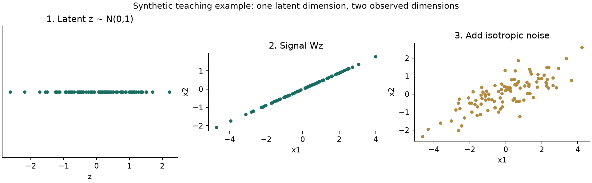

# PCA 文献阅读室

## 先建立地图，再读六份资料 / A reading map for six sources

<div class="lead">从普通 PCA 出发，看懂 PCR、概率 PCA、核 PCA 和迭代计算。<br>One foundation, four directions for deeper study.</div>

老师给的资料不是六篇同类型论文：**三篇研究论文、两本书的相关章节、一篇 R 教程**。本阅读室为六份材料各给一份短总结，再用共同的符号讲核心原理。书籍只总结相关章节，不把泛读说成通读整本书。

<p class="en">The sources play different roles: textbooks establish the foundations, research papers develop methods, and the R tutorial shows an application workflow. Read each according to the question it can answer.</p>

|材料|本次阅读范围|主要问题|
|---|---|---|
|Bishop (2006), PRML|第 12 章，重点 §§12.1–12.3|几何 PCA 如何接到概率模型和核方法？|
|Jolliffe (2002), PCA, 2nd ed.|第 8 章，重点 §§8.1–8.2|用 PC 做回归，何时减方差，何时丢预测信号？|
|Tipping & Bishop (1999)|PPCA 全文主线；附录作为推导延伸|PCA 能否从最大似然得到？|
|Schölkopf, Smola & Müller (1997)|6 页 ICANN 会议论文|非线性特征空间里的 PCA 如何计算？|
|Andrecut (2009)|算法 §§2–3 与实验 §4|怎样更稳定、并行地计算几个主成分？|
|Michy Alice (2016), R-bloggers/MilanoR|PCR 教程与示例代码|如何在 R 中拟合、选维数和评价 PCR？|

### 推荐顺序 / Recommended order

**共同基础 → Bishop → Jolliffe + PCR 教程 → PPCA → Kernel PCA → 迭代/GPU → 综合比较。**

如果还分不清方差、载荷与 scores，先读 [Wine 教材基础](../wine-pca/#variance)。这里仍会补足每个新分支需要的知识，但不把“泛读”变成只记论文标题。每份至少要能答：问题是什么？核心方法是什么？关键公式各符号代表什么？证据支持到哪里？

<div class="callout">短总结是理解与改写的参考。用于自己的文献综述时，回到原文核对并用自己的表达组织。各页原文入口均指向出版者、作者或公开预印本；这里不公开整本版权 PDF。</div>

### 六份独立短总结 / Open a short summary on its own

[Bishop 第 12 章](summaries/bishop.html) · [Jolliffe 第 8 章](summaries/jolliffe.html) · [R PCR 教程](summaries/blog.html) · [概率 PCA](summaries/ppca-summary.html) · [核 PCA](summaries/kernel-summary.html) · [迭代与 GPU PCA](summaries/gpu-summary.html)。也可[下载六份短总结文本](six-brief-summaries.md)。

### 泛读时具体做什么？ / A three-pass method

1. **定位：**读摘要、引言结尾、结论，写一句研究问题。
2. **抓骨架：**读方法核心公式、算法步骤、实验图的坐标与条件；把不懂的前置概念列出来。
3. **复述与判断：**合上原文，说出一条贡献、一条限制、与自己 Wine 汇报的一条联系。

<p class="en">A useful brief summary identifies the problem, the mechanism, the evidence and its scope. It should let another reader distinguish the paper from ordinary PCA.</p>

## 共同基础：六份资料怎样接在一起？ / The mathematical bridge between the readings

统一用 n 表示观测数，p 表示观测变量数，q 表示保留的维数。Xc 是 n×p 中心化数据。SVD 写作 Xc=U S Vᵀ；用 S 表示奇异值矩阵，避免把它和协方差 C 混淆。普通样本协方差是 C=XcᵀXc/(n−1)。

$$\max_{\|w\|=1} w^TCw\quad\Longrightarrow\quad Cw=\lambda w$$

最大方差给出前 q 个特征向量 Vq；scores 为 T=XcVq；重建 X̂c=TVqᵀ。保留总方差越多，同一尺度下的总平方重建误差越小。

<p class="en">Ordinary PCA chooses a linear subspace that preserves variance, equivalently minimises squared reconstruction error. Every extension below changes a different part of that setup.</p>

|分支|保留什么|新加什么|评估什么|
|---|---|---|---|
|PCR|PCA 的线性坐标|一个待预测的 y、回归、维数选择|未见数据的预测误差|
|PPCA|主子空间|潜变量、噪声分布、似然|概率拟合、预测密度、缺失值处理|
|Kernel PCA|特征空间中最大方差|非线性映射与核函数|任务表现；依核而定的几何|
|NIPALS / GS-PCA / GPU|普通 PCA 的数值目标|迭代求解、正交化、并行实现|误差、正交性、时间、内存|

### 先修知识只补到能用 / Prerequisites that matter

**回归 regression：**给定 predictors X，找系数让预测 ŷ 接近实际 y。最小二乘把残差平方相加后最小化。

**概率模型 probability model：**给数据可能出现的位置赋予概率密度。似然 likelihood 把已观察数据固定，问哪组模型参数更支持这些数据。

**潜变量 latent variable：**模型里用来解释观测的隐藏坐标。例如 13 项测量可能由少数共同因素加噪声生成；隐藏坐标不是已知品种标签。

**核 kernel：**用 k(x,y) 直接算某个特征空间中两个映射点的内积。它需要合适的半正定性，不是随便一个“相似度”都可以。

**迭代 iteration：**从初始猜测开始，反复执行改进步骤，直到变化或残差足够小。快速与准确是两个独立问题。

<details><summary>检查：哪一种方法改变了科学模型，哪一种主要改变了算得多快？</summary><p>PPCA 增加概率生成模型，Kernel PCA 改变特征空间，PCR 增加预测任务；GPU 实现本身主要改变计算方式。GS-PCA 的正交化还改善浮点数下的数值性质。Changing the hardware does not itself create a nonlinear or probabilistic PCA model.</p></details>

## 短总结 1：Bishop 第十二章 / Summary 1: Bishop, Continuous Latent Variables

**书目信息：**Christopher M. Bishop (2006), *Pattern Recognition and Machine Learning*, Springer, Chapter 12 “Continuous Latent Variables”，印刷页 559–604。重点阅读 §12.1 PCA（561–570）、§12.2 Probabilistic PCA（570–586）、§12.3 Kernel PCA（586–590）。提供的扫描本 PDF 页码通常为印刷页码加 20；文字 OCR 有错误，以页面图像为准。

**短总结（中文）：**本章把 PCA 放在连续潜变量模型的框架下。它先证明最大投影方差与最小平方重建误差会得到相同主子空间，再说明带各向同性高斯噪声的线性潜变量模型在最大似然下恢复该子空间。概率形式提供密度、EM 估计、缺失数据和混合模型等扩展。核 PCA 则把线性 PCA 搬到隐式非线性特征空间，利用核矩阵计算。对本项目最有用的是把几何、线性代数与统计建模接起来，同时提醒我们：普通 PCA 的计算并不要求数据高斯，而 PPCA 的概率解释确实依赖相应分布假设。

**Brief summary (English):** Chapter 12 connects PCA with continuous latent-variable models. The maximum-variance and minimum-reconstruction-error formulations lead to the same principal subspace. A linear Gaussian latent-variable model with isotropic noise recovers that subspace through maximum likelihood and supports extensions such as EM estimation, missing-data treatment and mixtures. Kernel PCA extends the geometry to an implicit feature space. The chapter is particularly useful for distinguishing the algebraic properties of ordinary PCA from the probabilistic assumptions introduced by PPCA.

### 读哪几个地方才抓住骨架？ / Reading anchors

- **§12.1.1**：为什么约束 wᵀw=1，为什么得到 eigenvalue equation。
- **§12.1.2**：重建误差与丢掉的特征值之和；联系 Wine 图只保留两轴。
- **§12.1.4**：p 很大而 n 较小时，为什么可以考虑 n×n 的 Gram matrix。
- **§12.2**：x=Wz+μ+ε；观察空间与潜空间各自维数。
- **§12.3**：把所有必需运算改写成内积，再替换为 kernel。

<p class="en">Read this chapter as a conceptual bridge, not as a list of algorithms to memorise. For each equation, identify the space in which its vectors live.</p>

### 你需要能解释的一个证明 / The key equivalence

正交投影的残差与保留分量垂直，所以每个点的平方长度等于两部分平方长度之和。对全部点求和，总平方长度固定，因此保留部分最大就等价于残差最小：

$$\|X_c\|_F^2=\|X_cV_q\|_F^2+\|X_c-X_cV_qV_q^T\|_F^2$$

普通 PCA 的最优性仅针对这个平方欧氏误差。若变量先标准化，就在标准化空间中成立；若你关心预测 y、非线性曲线上的距离或抗离群点误差，还需要其他目标或方法。

<details><summary>复述题：为什么普通 PCA 不需要高斯，但 PPCA 需要说分布？</summary><p>协方差、SVD、最优秩 q 近似都是代数与优化结果，可对一般有限数值矩阵计算。PPCA 额外定义 p(x)，最大似然与后验推断必须依赖它设定的高斯潜变量与噪声模型。</p></details>

原文入口：[Bishop 作者书籍页](https://www.microsoft.com/en-us/research/people/cmbishop/prml-book/)。

## 短总结 2：Jolliffe 第八章 / Summary 2: Jolliffe, Principal Components in Regression

**书目信息：**I. T. Jolliffe (2002), *Principal Component Analysis*, 2nd edition, Springer。第 8 章 “Principal Components in Regression Analysis”，印刷页 167–198；本次重点 §§8.1–8.2（168–176），相关比较在 §8.3。提供文件的 PDF 页码为印刷页码加 31。

**短总结（中文）：**第八章研究如何用主成分代替原预测变量进行回归。使用全部主成分只是正交换坐标，等价于普通最小二乘；删去某些成分才会改变估计。小特征值方向会放大回归系数估计的方差，删除它们可提高稳定性，但通常引入偏差。核心提醒是：预测变量中方差小的方向，仍可能与响应高度相关，因此不能只按 PCA 的解释率决定回归保留哪些成分。本章通过公式、选成分策略和实际案例展示稳定性与预测信息之间的取舍，是 PCR 教程的理论补充。

**Brief summary (English):** Chapter 8 explains regression on principal-component scores. Retaining all components gives the same fitted model as ordinary least squares, while discarding components changes the estimator. Small-eigenvalue directions can cause large coefficient variance, so truncation may improve stability at the cost of bias. Crucially, a low-variance component can still be strongly related to the response. The chapter therefore distinguishes variance preservation from predictive usefulness and discusses component-selection strategies and examples.

### 本章最值得带走的反例 / A concrete warning from the chapter

表 8.1（印刷 p.174）讨论季风日期回归。书中第 10 个 PC 对 predictors 总变异的份额不足 1%，却对响应有重要作用；第 8 个 PC 只占 X 变异约 3%，表中对 y 的解释约 24%。这不是我们的 Wine 实验，而是书中引用的气象案例，用来说明“高方差方向”与“高预测价值”可能分离。

<p class="en">The monsoon example in Table 8.1 illustrates that variance in X and relevance to y are distinct. It provides a substantive counterexample to choosing PCR components solely by explained predictor variance.</p>

### 阅读问题 / Questions to take to the text

1. §8.1 中为什么全部 PC 的回归与 OLS 等价？
2. 为什么小特征值进入估计方差时在分母？
3. 删除一个方向为什么通常产生偏差？
4. §8.2 中两个相冲突的目标是什么？

<details><summary>四点短答 / Short answers</summary><p>正交基不改变预测空间；OLS 中要反演 XᵀX，小特征值的倒数很大；被删除方向上的真实系数被强制为 0；目标分别是消除不稳定方向与保留对 y 有用的信号。</p></details>

原文入口：[Springer / DOI](https://doi.org/10.1007/b98835)。书名是 *Principal* Component Analysis，文件名里的 “Principle” 不是正式书名。

## PCR 原理：从回归零基础到偏差—方差取舍 / PCR: regression, orthogonal coordinates, and truncation

### 1. 普通线性回归在找什么？ / What is regression fitting?

给定 n 个响应 y 和 n×p 的 predictors X，模型 y=Xβ+ε。为了简化写法，这里 X 与 y 都已中心化；实际预测时需要加回响应均值。最小二乘选择 β 使 Σ(yᵢ−ŷᵢ)² 最小。如果 X 满列秩：

$$\hat{\beta}_{OLS}=(X^TX)^{-1}X^Ty$$

两列几乎重复时，许多系数组合会给出差不多的预测。例如 x₂≈x₁，把 β₁ 加 100、β₂ 减 100，拟合值可能几乎不变。于是样本稍变，系数可能大变。这叫 multicollinearity（多重共线性）造成的不稳定。

<p class="en">Collinear predictors make individual regression coefficients unstable because very different coefficients can produce similar fitted values.</p>

### 2. 换到 PCA 坐标 / Rotate to PCA coordinates

设 X=USVᵀ，令 T=XV=US。用 T 回归得到系数 γ，与原 β 的关系是 β=Vγ。如果保留所有非零方向，预测空间相同；仅把列变得正交，不会凭空消除统计不稳定性。

### 3. 只保留 q 个方向 / Truncate

$$\hat{\beta}_{PCR,q}=V_qS_q^{-1}U_q^Ty,\qquad \hat{y}=U_qU_q^Ty$$

解释每一段：Uqᵀy 量出 y 在保留样本方向上的成分；Sq⁻¹ 按奇异值缩放；Vq 把回归系数送回原变量空间。小奇异值对应的 1/σ 很大，删除这些方向可以避免这种放大。

在独立同方差误差 Var(ε)=τ²I、固定 X 的模型下：

$$\operatorname{Var}(\hat{\beta}_{OLS})=\tau^2 V S^{-2}V^T$$

PCR 删除一些项，降低相应估计方差；但 E(β̂PCR)=VqVqᵀβ，真实 β 在删掉子空间的部分无法估出来，产生偏差。估计误差常用 **MSE = variance + bias²** 衡量；降低方差未必足以抵消偏差。

<p class="en">PCR trades variance for bias. Truncating small-singular-value directions can stabilise estimation, but loses any real response signal in those directions.</p>

### 4. 一个能手算的失败例子 / A simple failure case

假设两列已经不相关，Var(x₁)=100、Var(x₂)=1，而 y=x₂。PCA 第一方向是 x₁，保留约 99% 的 X 方差；只用第一 PC 做 PCR 却丢掉了完整预测信号。保留第二 PC 才直接知道 y。

<div class="interactive" id="pcr-lab"><h3>方差与预测价值是两个开关 / Variance is not predictive relevance</h3><label>响应来自 <select id="pcr-target"><option value="low">低方差方向 x₂ / Low-variance x₂</option><option value="high">高方差方向 x₁ / High-variance x₁</option></select></label><label>保留成分 <select id="pcr-k"><option value="1">只留 PC1</option><option value="2">保留 PC1、PC2</option></select></label><p id="pcr-result" aria-live="polite"></p><p>理想化的总体例子：两方向独立、均值为 0，无噪声。它用于解释机制，不是实际测试集的测量值。</p></div>

### 5. 怎样选择 q？ / Select q using the task

预测任务用交叉验证误差，例如 RMSE=√mean((y−ŷ)²)。每一折都只用该折训练数据估计均值、SD、PCA 方向，再投影验证数据。选好 q 后，在所有训练数据上重拟合，最后只评估一次保留的测试集。不能用测试集反复挑 q 再把最小误差当独立评价。

**PCR 与 PLS：**PCR 方向仅由 X 决定，再回归 y；PLS 在构造潜在方向时考虑 X 与 y 的关系。PLS 也需要验证，不能自动保证更好。

**PCR 与 ridge：**PCR 对部分方向完全删除；ridge 对所有方向连续收缩。以 α>0 表示 ridge 惩罚时，其 SVD 系数因子是 σ/(σ²+α)，而 OLS 是 1/σ。

<details><summary>检查：PCR 是变量选择吗？ / Is PCR variable selection?</summary><p>通常不是。保留一个 PC 仍可能包含所有原变量的非零系数。它选择的是线性组合方向，而不是直接筛掉某几列。</p></details>

## 短总结 3：R-bloggers 的 PCR 教程 / Summary 3: the R PCR tutorial, read critically

**书目信息：**Michy Alice, “Performing Principal Components Regression (PCR) in R”, R-bloggers / MilanoR，网页显示 2016 年 7 月 20 日。它是教学博客，不是同行评审研究论文。

**短总结（中文）：**文章介绍先把 predictors 转成主成分、再用选定成分做线性回归的 PCR 流程。它使用 iris 和 R 的 pls 包，演示 pcr、交叉验证、RMSEP、预测和回归系数图，并提醒 PCA 方向不使用响应，因此高解释率不保证预测效果。教程适合作为软件入口，但示例代码有需修正的地方：训练集与测试集都包含第 120 行，按行号切分又遇到 iris 按品种排序；示例还把 Species 纳入公式并产生虚拟变量。复现时应明确 predictors、使用不重叠且适合任务的划分，并通过训练内验证选择成分数。

**Brief summary (English):** The tutorial demonstrates PCR with the pls package using iris, including fitting, cross-validation, RMSEP and prediction. It correctly highlights the distinction between predictor variance and response relevance. The example should nevertheless be read critically: row 120 appears in both training and test sets, the split follows the ordered iris rows, and the formula includes Species through dummy coding. A careful reproduction should define the predictors explicitly, prevent overlap and choose model complexity using training-data validation.

### 三处值得动手核查 / Three checks on the example

1. `train <- iris[1:120, ]` 与 `iris[120:150, ]` **共同包含第 120 行**。这是真正的数据重叠，不是“不同随机种子”的问题。
2. `Sepal.Length ~ .` 的点表示“数据表中除响应外的其他列”，因此把 Species 也放进去了。3 个水平通常产生 2 个指示变量，连同 3 个数值 predictors，示例显示 X dimension 为 5。它不同于只用三个连续测量。
3. 示例输出最多 5 个成分，正文却写 “6 components explain all the variability”。这是应核对的笔误；不要把它当 PCA 的规则。

<p class="en">These checks illustrate active reading: inspect what the formula actually includes, whether the data split is disjoint, and whether the prose agrees with the printed output.</p>

### 更清楚的初学者练习 / A clearer beginner exercise

此处只用三个数值测量预测 Sepal.Length，明确避免把类别变量混进基础例子。打开已有 R 项目，新建 `pcr_practice.R`，分段输入；界面操作见 [Wine 的逐步截图](../wine-pca/#windows)。`iris` 随 R 提供，不需下载。该练习演示流程，不声称 PCR 会胜过 OLS。

```r
dat <- iris[, c("Sepal.Length", "Sepal.Width",
                "Petal.Length", "Petal.Width")]
set.seed(1000)
train_id <- sample(seq_len(nrow(dat)), 120)
train <- dat[train_id, ]
test <- dat[-train_id, ]
length(intersect(train_id, setdiff(seq_len(nrow(dat)), train_id)))
```

`sample` 随机取行号，`-train_id` 取剩下的行，最后应为 0，证明无重叠。这里是普通独立样本教学设定；时间序列、同一人重复观测等应按时间或组划分，不能直接随机打乱。

```r
install.packages("pls")  # 只需安装一次 / install once
library(pls)            # 每次新会话载入 / load each session
set.seed(1000)
fit <- pcr(Sepal.Length ~ ., data = train,
           scale = TRUE, validation = "CV", segments = 10)
summary(fit)
validationplot(fit, val.type = "RMSEP")
```

安装语句需要联网；看到镜像选择时选可用 CRAN mirror。`library` 找不到包就先确认安装成功。这个清楚定义的模型最多只有 3 个 PC。图上横轴是成分数，纵轴是预测误差，越低越好；不要把训练 X 的解释率当作它。

```r
cv <- drop(RMSEP(fit, estimate = "CV")$val[1, 1, ])
best_q <- which.min(cv[-1])
pred <- drop(predict(fit, newdata = test, ncomp = best_q))
sqrt(mean((pred - test$Sepal.Length)^2))
```

`cv[1]` 对应仅截距的 0 成分基线；这里在 1–3 成分候选中选择最小值，真实分析也应比较基线是否更好。`drop` 去掉多余数组维度。测试 RMSE 的单位与 Sepal.Length 相同。数值随软件版本和验证划分可能变化，应报告你自己实际运行的结果，而不是复制原博客的 0.213731。

**关于缩放和验证：**`pls::pcr` 的此类基本模型在各验证段重新估计模型及缩放；若你手工先在整个数据表上 `scale` 再交给验证，就失去这一隔离。复杂公式和预处理应阅读所用包的交叉验证说明，必要时显式写折内流程。

原文：[R-bloggers PCR tutorial](https://www.r-bloggers.com/2016/07/performing-principal-components-regression-pcr-in-r/)；软件：[CRAN pls](https://cran.r-project.org/package=pls)。

## 短总结 4：Tipping 与 Bishop 的概率 PCA / Summary 4: Tipping & Bishop (1999), Probabilistic PCA

**书目信息：**Michael E. Tipping and Christopher M. Bishop (1999), “Probabilistic principal component analysis”, *Journal of the Royal Statistical Society: Series B*, 61(3), 611–622。正文关键为 §3（概率模型与最大似然）和 §4（例子）；附录 A 讨论似然驻点，附录 B 给 EM。

**短总结（中文）：**论文为 PCA 建立线性高斯潜变量模型：观测由低维潜变量经线性映射后加各向同性噪声生成。作者证明最大似然解的载荷矩阵张成普通 PCA 的主子空间，噪声方差为舍弃特征值的平均，并给出 EM 算法。这一概率解释使 PCA 能用于密度建模、含缺失值的数据和多个局部模型的混合。文中用 Tobamovirus 数据展示这些用途。关键限制是线性结构和各向同性高斯噪声；PPCA 的后验均值坐标一般并不等于普通 PCA scores，单个 PPCA 也不是自动非线性的。

**Brief summary (English):** The paper derives PCA as maximum-likelihood estimation in a linear latent-variable model with isotropic Gaussian noise. The fitted loading matrix spans the principal eigenspace, and the estimated noise variance is the mean of the discarded eigenvalues. An EM algorithm and examples illustrate missing-data analysis, mixtures and constrained density modelling. The model retains linear and Gaussian assumptions, and its posterior latent coordinates are generally not the ordinary PCA scores. Its contribution is a probabilistic framework, rather than a universal improvement in reconstruction accuracy.

### 原文证据 / Evidence in the paper

- **§3.1，p.614：**观测协方差 WWᵀ+σ²I；后验均值与协方差。
- **§3.2，pp.614–615：**最大似然 W 与噪声估计。
- **§4.1，p.616：**38 个样本、18 维 Tobamovirus 数据；随机按 20% 概率删除数据值，示例图仍保留主要结构。图注报告 136 个缺失值。
- **§4.2：**三个局部 PPCA 模型的混合示例。
- **§4.3：**比较密度模型的预测负对数似然；这里不能把“prediction error”误读成分类错误率。

<p class="en">The examples demonstrate what becomes possible once a probability model is available. They do not establish that PPCA is superior for every dataset or missingness mechanism.</p>

对 Wine 项目，最直接的联系是把“方差方向”解释为一个线性生成模型的主子空间。但本次 Wine 没有缺失，也没有拟合概率密度，所以不能把 PPCA 的优势写成自己的实验结果。

原文入口：[作者论文页面](https://www.microsoft.com/en-us/research/publication/probabilistic-principal-component-analysis/)，[DOI](https://doi.org/10.1111/1467-9868.00196)。

## PPCA：从“隐藏坐标加噪声”开始 / PPCA: a generative model, likelihood and the PCA connection

### 1. 用一个故事读公式 / Read the model as a data-generating story

$$x=Wz+\mu+\epsilon,\qquad z\sim N(0,I_q),\qquad \epsilon\sim N(0,\sigma^2 I_p)$$

x 是 p 维观测，z 是 q 维隐藏坐标，W 为 p×q，μ 是 p 维均值。假设 z 与 ε 独立。先抽一个低维 z，用 W 把它送到观测空间，加平均位置，再加随机噪声，生成一条观测。

<p class="en">PPCA generates a high-dimensional observation from a low-dimensional Gaussian latent vector plus independent isotropic Gaussian noise.</p>

**isotropic 各向同性**表示噪声在所有观测方向有相同方差 σ²，协方差矩阵是 σ²I。不是说数据总协方差是球形；Wz 提供有方向的相关结构。

### 2. 为什么协方差是 WWᵀ+σ²I？

均值 E(x)=μ。独立部分的协方差相加，Var(Wz)=W Var(z) Wᵀ=WWᵀ，因此：

$$x\sim N(\mu,C_{model}),\qquad C_{model}=WW^T+\sigma^2I_p$$

W 的列张成低维信号子空间，剩下方向只有噪声。若 q=1、W=(2,0)ᵀ、σ²=1，则观测协方差为 diag(5,1)，点云横向更长。这把“细长点云”与概率生成联系起来。



### 3. 最大似然在优化什么？ / What does maximum likelihood fit?

对于独立样本，最大化各点密度乘积，等价于最大化对数密度之和。设 Cmodel 为上式，Sml=XcᵀXc/n，则去掉与参数无关的部分后：

$$\ell=-\frac{n}{2}\left[\log|C_{model}|+\operatorname{tr}(C_{model}^{-1}S_{ml})\right]+\mathrm{constant}$$

第一项与模型体积有关，第二项与数据在模型度量中的散布有关。不能一味把协方差放大让所有点“离中心近”：体积项会惩罚这种做法。

**分母警报：**论文最大似然协方差用 **n**，普通 `prcomp` 的 sdev² 对应 **n−1**。方向一致，特征值差一个 (n−1)/n 的系数。读不同资料必须先统一约定。

### 4. 关键结果：主子空间回来了 / The principal subspace reappears

令 λ₁≥…≥λₚ 是 Sml 的特征值，Vq 是前 q 个特征向量，Λq 为对应对角矩阵。在通常的非退化情形、q &lt; p 时：

$$\hat\sigma^2=\frac{1}{p-q}\sum_{j=q+1}^{p}\lambda_j,\qquad \hat W=V_q(\Lambda_q-\hat\sigma^2 I_q)^{1/2}Q$$

Q 是任意 q×q 正交矩阵。舍弃方向的平均方差估计噪声；保留特征值减去噪声底，再开方决定 W 的尺度。Vq 出现了，所以 W 的列空间就是 PCA 的主子空间。但 W 不一定正交归一，别直接称它为 `prcomp$rotation`。

<p class="en">PPCA recovers the same principal subspace at maximum likelihood. The loading matrix has additional scale and rotation freedom; it is not simply the matrix of unit eigenvectors.</p>

**手算例子：**p=3、q=1、特征值 (5,2,1)。σ̂²=(2+1)/2=1.5，W 可取 √3.5 v₁。模型协方差特征值为 (5,1.5,1.5)：最大方向匹配，较小两方向被统一的噪声水平近似。

### 5. 看到 x 后，怎样猜 z？ / Infer the latent coordinates

$$E[z\mid x]=(W^TW+\sigma^2I_q)^{-1}W^T(x-\mu)$$

这一般不同于普通 PCA 的 Vqᵀ(x−μ)。后验还具有协方差 σ²(WᵀW+σ²I)⁻¹，表示隐藏坐标的不确定性。噪声较大时，推断更保守，重建 W E[z|x]+μ 会向均值收缩，因此不等同于普通正交投影的最小平方误差重建。

### 6. EM 不是什么神秘黑箱 / The idea of EM

**E-step：**用当前 W、σ² 计算隐藏 z 的条件期望与二阶矩。**M-step：**利用这些期望更新 W、σ²，让期望完全数据对数似然提高。反复执行。EM 提供另一种拟合路线；不能说“所有概率模型都只能 EM”，因为完整数据 PPCA 有上面的显式解。

若有缺失观测，可把它们也视为未观察变量并在合适缺失机制假设下处理。模型能利用观测到的相关结构，但不会神奇恢复所有被删信息。多个 PPCA 的混合可以描述更复杂的全局结构；单个 PPCA 仍是线性高斯模型。

### 与 factor analysis 的区别 / Factor analysis

普通因子分析的噪声协方差 Ψ 可为不同对角元素；PPCA 限制 Ψ=σ²I。因此一般因子分析不会恰好给出普通 PCA 主子空间。标准化是数据变换，也不等于证明真实噪声满足各向同性。

<details><summary>自测：在 (5,2,1) 的例子里，为什么不直接令噪声为 1？</summary><p>PPCA 的最大似然在两个舍弃方向共享一个噪声值，最优值是它们的平均 1.5，而不是最小值。用 1 会系统低估第二方向的散布。</p></details>

## 短总结 5：Kernel Principal Component Analysis / Summary 5: Schölkopf, Smola & Müller, Kernel PCA

**书目信息：**Bernhard Schölkopf, Alexander Smola and Klaus-Robert Müller (1997), “Kernel Principal Component Analysis”, *Artificial Neural Networks—ICANN ’97*, LNCS 1327, pp.583–588。用户提供的是这篇 6 页会议论文，不是同作者 1998 年更长的 “Nonlinear Component Analysis as a Kernel Eigenvalue Problem”。

**短总结（中文）：**论文把 PCA 推广到通过非线性映射得到的特征空间。关键是把算法写成样本之间内积的形式，再用核函数直接计算这些内积，从而不必显式构造可能极高维的特征。算法对中心化核矩阵求特征向量，按特征空间单位长度要求归一化，并通过与训练样本的核值计算新样本坐标。论文用合成例子和 USPS 手写数字说明非线性特征的作用。优势依赖核与任务；计算仍需处理样本数平方级的核矩阵，而且特征空间中的重建通常难以直接映回输入空间。

**Brief summary (English):** The paper extends PCA to a nonlinear feature space by expressing the required computations through inner products and replacing them with kernel evaluations. Principal coordinates can be obtained from a centred Gram matrix without explicitly constructing the feature map. Toy examples and USPS digit experiments illustrate the usefulness of nonlinear features. The approach still depends on the kernel choice and sample-size costs, while reconstruction in the original input space is generally difficult. Its optimality concerns variance in the chosen feature space, not every downstream task.

### 实验说了什么？ / What do the experiments show?

§3（pp.586–587）在 USPS 数据上使用核 PCA 特征，再训练线性分离超平面分类器。原文数据库共 9300 个样本，其中测试集 2000；计算核矩阵时使用 3000 个训练样本的子集。线性 PCA 128 个成分时最佳错误率约 8.6%；相同数量的非线性成分约 6%；某些更高阶核、2048 个成分时约 4%。

这里比较的是**特征提取加分类器的测试错误率**，不是核 PCA 自己产生标签，也不是解释方差比例。它还是特定数据和实验设置的历史结果，不是现代通用性能承诺。

<p class="en">The classifier uses the labels; kernel PCA extracts the features. Better classification in this experiment supports the usefulness of those features in that setting.</p>

阅读重点：§2 式 (5)–(10) 的特征向量展开与投影，p.586 的中心化公式，§4 的计算代价与重建讨论。

原文入口：[Springer 会议论文 DOI](https://doi.org/10.1007/BFb0020217)。

## 核 PCA：不画高维空间，也能计算 / Kernel PCA: the feature map, Gram matrix and centring

### 1. 为什么直线有时不够？ / Why change the feature space?

普通 PCA 的新坐标是 x 的线性组合。如果数据沿弯曲结构变化，一根直线可能无法很好表达这种结构。核 PCA 先概念性地把 x 映射到 φ(x)，再在那个空间做线性 PCA。映回原输入看，坐标函数可能是非线性的。

<p class="en">Kernel PCA is linear PCA in a feature space and a nonlinear transformation of the original inputs. The kernel determines which geometry is being explored.</p>

### 2. 手算一个 kernel trick / A concrete feature map

二维 x=(x₁,x₂)，定义 φ(x)=(x₁²,√2x₁x₂,x₂²)。那么：

$$\phi(x)^T\phi(y)=x_1^2y_1^2+2x_1x_2y_1y_2+x_2^2y_2^2=(x^Ty)^2$$

因此 k(x,y)=(xᵀy)² 可以直接给出三维特征内积。高维高阶时，显式特征可能非常多，核计算仍只需要输入向量的点积与幂。这里的 √2 让交叉项系数正确，不能随意省掉。

### 3. 核矩阵是什么？ / The Gram matrix

Kᵢⱼ=k(xᵢ,xⱼ)，所以 K 是 n×n，不是 p×p。它比较的是样本与样本。有效内积核的任意有限 Gram matrix 都应对称半正定。常见例子：线性核 xᵀy，合适参数的多项式核，RBF 核 exp(−‖x−y‖²/(2ℓ²))。

ℓ 控制局部程度：很小的 ℓ 让大多数不同样本几乎不相似；很大的 ℓ 让它们几乎都相似。核选择与参数需要研究目标和验证，不能见到“非线性”就默认更好。

### 4. 中心化必须在特征空间 / Centre where PCA is performed

就算原数据 Σxᵢ=0，通常也没有 Σφ(xᵢ)=0。例如 x=−1、1 的平均是 0，映射成 x² 后二者都为 1，平均变成 1。定义 H=I−11ᵀ/n，则：

$$K_c=HKH$$

逐项就是“减该行均值、减该列均值、加全体均值”。它对应中心化后的特征向量内积，虽然我们没显式算 φ。

**手算：**K=[[1,2],[2,5]]，行均值 1.5、3.5，总均值 2.5；Kc=[[0.5,−0.5],[−0.5,0.5]]。每行和为 0，特征值为 1、0。

<div class="interactive" id="kernel-lab"><h3>核中心化检查 / Check kernel centring</h3><p>固定例子 K=[[1,2],[2,5]]。你预计中心化后第一行和是多少？</p><button id="kernel-reveal">显示每一步 / Show the calculation</button><div id="kernel-result" hidden>第一项：1−1.5−1.5+2.5=0.5。第二项：2−1.5−3.5+2.5=−0.5。第一行和=0；中心化在特征空间移走了平均位置。</div></div>

### 5. 特征值、归一化与坐标 / Eigenvalues and normalisation

求 Kc a=ρa，取 ρ>0 且 aᵀa=1。对应特征空间方向 v=(Σaᵢφc(xᵢ))/√ρ。它的长度平方为 aᵀKc a/ρ=1。训练样本的该轴 scores 为 √ρ a。

$$\lambda_{feature}=\frac{\rho}{n}\quad\mathrm{or}\quad\frac{\rho}{n-1}$$

原论文按 1/n 定义特征空间协方差；若使用样本 n−1 约定，改分母即可。ρ 是核矩阵特征值，不能未经分母换算直接叫协方差特征值。

### 6. 新样本如何投影？ / A new observation

对新点 x*，先算与训练样本的核值，再使用**训练特征均值**中心化：

$$k_c(x_i,x_*)=k(x_i,x_*)-\frac{1}{n}\sum_l k(x_i,x_l)-\frac{1}{n}\sum_l k(x_l,x_*)+\frac{1}{n^2}\sum_{l,m}k(x_l,x_m)$$

score 为 Σaᵢkc(xᵢ,x*)/√ρ。不要把测试点重新加进训练核矩阵来“更新中心”，否则预测评价的训练/测试边界变了。

### 7. 成本与解释 / Costs and interpretation

完整存储 K 约 O(n²)，一般稠密特征分解约 O(n³)。核方法避免显式特征维度爆炸，却没有消除样本数成本。可研究近似方法，但那是额外算法。核 PCA 轴上的解释率是特定核特征空间的比例，不能与 Wine 原始或标准化解释率直接打分比较。

**pre-image problem：**在特征空间重建了一个点，未必存在原输入 x 正好映射到它，也未必容易找到。因此普通线性 PCA 那种“乘回 Vᵀ”不直接给出输入空间重建。

<details><summary>练习：x=(1,2)、y=(3,4)，二次核值是多少？</summary><p>xᵀy=11，核值 121。显式特征内积为 1×9 + (2√2)(12√2) + 4×16 =9+48+64=121。两条路线一致。</p></details>

## 短总结 6：Andrecut 的迭代 PCA 与 GPU / Summary 6: Andrecut (2009), iterative PCA on GPUs

**书目信息：**M. Andrecut (2009), “Parallel GPU Implementation of Iterative PCA Algorithms”, *Journal of Computational Biology*, 16(11), 1593–1599，DOI 10.1089/cmb.2008.0221。PDF 共 8 页，最后一页为空白/下载标记；正文为 7 个印刷页。

**短总结（中文）：**文章关注大矩阵 PCA 的计算效率与数值正交性。NIPALS 逐个迭代估计主成分，但浮点误差可能使先后得到的载荷和得分不再充分正交。作者提出在迭代中对两侧向量进行 Gram–Schmidt 再正交化的 GS-PCA，并用 NVIDIA CUBLAS 在 GPU 上实现两种算法。论文在指定 2009 年硬件和随机矩阵测试中报告最高约 12 倍 CPU/GPU 时间比，GS-PCA 额外耗时约 5–7%。贡献是保留 PCA 目标的计算改进；这些结果不能直接推广到今天的小型 Wine 数据或所有硬件。

**Brief summary (English):** The paper addresses the speed and numerical orthogonality of iterative PCA for large matrices. It augments sequential NIPALS-style computation with Gram–Schmidt re-orthogonalisation of the left and right vectors, and implements the algorithms using GPU CUBLAS. The reported benchmark achieves up to about twelve-fold speed-up over the specified CPU implementation, with a modest additional cost for GS-PCA. The contribution concerns computation rather than a new statistical PCA objective; the timing results depend on matrix size, implementation and hardware.

### 报告性能必须带上的条件 / Benchmark conditions

§4 使用 AMD Phenom 9950 CPU（2.6 GHz）、XFX GTX280 GPU、CUDA 2.0、GSL 1.11 等指定环境。随机矩阵行数 M 从 500 到 15000，列数 N=M/2，提取 K=10 个成分，收敛阈值 ε=10⁻⁷。最高约 12 倍发生在最大规模处。GPU 具有 240 个 stream processors、1 GB 显存，是该年代设备。

**它没有展示：**我们 178×13 Wine 数据在今天电脑上的 12 倍提升。对这样的小矩阵，传输、初始化和调度开销可能比实际计算更显著。评价算法时也应同时记录残差和正交性，不能只看运行时间。

<p class="en">A speed-up number is meaningful only with the baseline, precision, tolerance, matrix dimensions and hardware stated.</p>

### 读原文时注意符号 / Read the notation critically

论文的 SVD 符号与很多教材的 U、V 角色不同，并有把奇异向量/奇异值称作 eigenvectors/eigenvalues 的宽松表述。这里统一按矩阵维度辨认左右奇异向量，不把数据矩阵奇异值误当协方差特征值。原文强调“perfect orthogonality”；数值学习中更合适的理解是控制舍入造成的正交性损失，并实际测量误差。

原文入口：[出版者 DOI](https://doi.org/10.1089/cmb.2008.0221)，[作者预印本 arXiv:0811.1081](https://arxiv.org/abs/0811.1081)。

## NIPALS、再正交化与 GPU：逐步拆开 / NIPALS, re-orthogonalisation and parallel computation

### 1. 迭代为什么能找方向？ / Why does iteration find an eigenvector?

先看 power iteration（幂迭代）。若 C 的最大特征值严格大于次大值，初始 w 含有第一特征向量的非零分量，反复计算 Cw 再归一化，会放大第一方向的相对权重。

$$C^m w=\sum_j a_j\lambda_j^m v_j$$

除以最大尺度 λ₁ᵐ 后，其余项含 (λⱼ/λ₁)ᵐ，随 m 增大而减小。λ₂/λ₁ 接近 1 时收敛较慢；起始向量完全没有第一方向分量时，这个论证不成立。算法要设最大迭代次数与收敛检查。

<p class="en">Power iteration works by repeatedly amplifying the dominant eigencomponent. Its convergence depends on the spectral gap and the starting vector.</p>

### 2. NIPALS 可以不显式形成 C / Work with the data matrix

令 E=Xc 是残差矩阵，t 取一个非零初始列。反复：

$$p\leftarrow\frac{E^Tt}{\|E^Tt\|},\qquad t\leftarrow Ep$$

p 是单位方向，t 是对应 scores。将两步合起来看，方向更新与 EᵀEp 的幂迭代相连，所以在适当条件下找到当前主方向。收敛后减去已解释的秩一部分：

$$E\leftarrow E-tp^T$$

这个步骤叫 **deflation（消去/降阶）**。再在剩下的 E 中找下一个方向。最基本版本要处理零向量、收敛阈值和秩上限；有缺失值时要用相应变体，不能把这个完整数据公式直接当作缺失值算法。

### 3. 一个二维手算 / A short numerical example

取 C=diag(4,1)，起始 w∝(1,1)。一次乘 C 后方向比例为 (4,1)，两次后 (16,1)，三次 (64,1)，越来越贴近第一轴。归一化只控制长度，不改变这个比例。

<div class="interactive" id="power-lab"><h3>逐次迭代 / Step through power iteration</h3><p>C=diag(4,1)，w₀=(1,1)/√2。</p><button id="power-next">再迭代一次 / Next step</button> <button id="power-reset">重新开始 / Reset</button><p id="power-result" aria-live="polite"></p></div>

### 4. 已经消去了，为什么还会不正交？

精确算术下的理论正交性，不等于计算机浮点运算能无限精确维持。每次近似收敛、矩阵向量乘法、相减都有舍入误差，残差中可能残留以前方向的一点成分；多次提取后误差会积累。

若已求得正交归一方向组成 Q，想从新候选 v 中去掉旧方向，做：

$$v\leftarrow v-Q(Q^Tv)$$

Qᵀv 测出 v 在旧方向的坐标；Q(Qᵀv) 是它在旧子空间的投影；减掉后保留正交部分，再归一化。GS-PCA 在迭代内对左右向量做这种校正。再正交化提高可靠性，也增加计算工作。

### 5. GPU 究竟快在哪里？ / What can be parallelised?

矩阵向量乘法中，许多乘加可同时进行。GPU 适合大量相似运算；CUBLAS 提供优化过的线性代数操作，算法作者用它们搭建迭代流程。需要把数据从 CPU 主内存送入 GPU 显存，再把结果送回；传输与内存容量都构成成本。

**并行不等于迭代顺序消失：**一次迭代里的矩阵运算可并行，但下次迭代仍依赖上次结果，后一个成分也依赖消去步骤。可以加速的是内部工作，而不是随意乱序。

### 6. 怎样认真评价数值算法？ / A meaningful evaluation

|指标|检查的对象|
|---|---|
|相对重建残差 ‖X−USVᵀ‖F/‖X‖F|结果能否近似原矩阵|
|‖VᵀV−I‖F 与 ‖UᵀU−I‖F|奇异向量是否保持正交归一|
|与基准奇异值/子空间的差异|是否找到正确主方向|
|wall-clock time，含/不含传输分别说明|实际计算成本|
|精度、容差、维数、初始化|保证比较条件清楚|

不要只把 ‖TᵀT−I‖ 当得分正交性检查，因为 scores T=US 本来通常不归一。检查 TᵀT 非对角项，或先把列归一化再检查。

<details><summary>自测：在 GPU 上算 PCA，结果会自动变成非线性吗？</summary><p>不会。硬件实现不改变模型目标。Kernel PCA 的非线性来自 φ 或核函数，PPCA 的概率来自分布假设，GPU 只是并行计算平台。</p></details>

## 把六份资料连成一个研究问题 / Synthesis: choosing a direction with a reason

### 它们都叫 PCA，却回答不同问题 / Different questions, related tools

|你真正想问|最相关资料|该拿什么证据回答|
|---|---|---|
|尺度如何改变二维探索图？|Bishop/Jolliffe 基础 + Wine 实验|预处理、载荷、解释率、得分图、逐变量表示质量|
|能否用较少维度预测一个连续响应？|Jolliffe Ch.8 + PCR 博客|训练内维数选择与独立测试误差|
|如何表达观测噪声与隐藏坐标不确定性？|Tipping & Bishop + Bishop §12.2|模型假设、似然、后验、任务相关验证|
|线性轴看不清的结构能否用非线性特征表示？|Kernel PCA + Bishop §12.3|核选择、特征空间含义、下游任务表现|
|大矩阵只求少数 PC 能否更快且保持正交？|Andrecut|误差、正交性、时间、硬件与规模|

<p class="en">Choose a method by the question and evaluation criterion. A more complicated method is not automatically a better answer to the current question.</p>

### 对你的两页 Wine PPT，最自然的后续是什么？

保持主线清楚：先把尺度实验做完整，再选一个延伸。偏简单但有研究内容的路线是**预处理对 PCA 与后续预测的影响**。先研究单位变换、离群点、保留维数，再考虑用 PCR 预测某个真正连续的响应；需要注意不要用已经作为 predictor 的变量原样当响应。

如果任务是预测三种 cultivar，普通线性 PCR 并不是直接对应的分类模型；可用 PCA 特征加合适分类器，明确区分探索和预测。若选 PPCA，重点放在噪声与缺失数据；若选核 PCA，重点放在一个明确非线性结构；若选 GPU，必须有足够大且可控的计算问题。

### 从短总结写成文献综述 / From summaries to a review

不要六段顺序堆砌。可以按论证写：普通 PCA 的几何目标 → 目标与任务错位（PCR）→ 模型假设扩展（PPCA、kernel）→ 计算可行性（迭代/GPU）。每一段比较两个来源的关系，而不是仅换一种说法复述摘要。

<blockquote>PCA preserves variation in a chosen representation. The readings show that prediction, probability modelling, nonlinear structure and computational efficiency each require additional choices. These choices determine what “better” means and how it should be evaluated.</blockquote>

中文：PCA 保留的是某种表示方式里的变异；一旦任务变成预测、概率建模、非线性表示或加速计算，“更好”的定义和评估方式都需要随之明确。

### 一张可直接填写的阅读卡 / A reading record

<div class="reading-card"><label>文献 / Source<textarea data-note="source" placeholder="作者、年份、标题、读了哪些章节"></textarea></label><label>研究问题 / Question<textarea data-note="question" placeholder="用一句自己的话说明"></textarea></label><label>关键机制 / Mechanism<textarea data-note="mechanism" placeholder="一个核心公式及每个符号的含义"></textarea></label><label>证据与范围 / Evidence and scope<textarea data-note="evidence" placeholder="数据、比较方法、结果、尚未说明什么"></textarea></label><label>与我的项目的联系 / Connection<textarea data-note="connection" placeholder="可借鉴的一个选择、一个待做实验"></textarea></label><button id="save-notes">保存到本机浏览器 / Save locally</button> <button id="download-notes">导出自己的笔记 .txt / Export notes</button><p id="notes-status" aria-live="polite">笔记只留在当前浏览器，不上传。换设备不会自动同步。</p></div>

## 泛读验收：这些题能答，才算抓住核心 / Reading checks with worked answers

### 题 1：分清对象 / Identify the object

给出数据矩阵 X（n×p）。普通 PCA 的协方差矩阵、核 PCA 的核矩阵、PPCA 的 W、PCR 保留的 scores 分别多大？

<details class="question"><summary>展开答案 / Answer</summary><p>p×p、n×n、p×q、n×q。维度检查能防止把样本空间与变量空间混淆。普通 PCA 也可以在样本 Gram matrix 上计算，但那是另一条等价计算路线。</p></details>

### 题 2：PCR 反例 / Explain the failure

Var(x₁)=100、Var(x₂)=1、Cov=0，y=x₂。只留 PC1 会怎样？

<details class="question"><summary>展开答案 / Answer</summary><p>保留约 99% 的 X 方差，却没有保留预测 y 的方向。由 x₁ 不能恢复独立的 x₂，均值预测的总体 MSE 为 1。换成 y=x₁ 时同样的 PC1 就很有用，说明应先说明目标。</p></details>

### 题 3：PPCA 手算 / Fit the covariance model

最大似然样本协方差特征值为 (8,3,1)，p=3，q=1。求噪声和模型特征值。

<details class="question"><summary>展开答案 / Answer</summary><p>σ²=(3+1)/2=2；W=√6 v₁（可差一个符号）；WWᵀ+2I 的特征值为 (8,2,2)。最大方向匹配，较小两个方向被共同噪声近似。</p></details>

### 题 4：普通 PCA 与 PPCA / Same subspace, same scores?

最大似然主子空间相同，是否说明两者坐标总完全一样？

<details class="question"><summary>展开答案 / Answer</summary><p>否。普通 scores 为 Vqᵀ(x−μ)，PPCA 后验均值还含 W 的尺度、旋转以及噪声引起的收缩。子空间一致不等于所有坐标表示一致。</p></details>

### 题 5：核中心化 / Where is the mean?

x=−1、1 已中心化，φ(x)=x² 是否已中心化？

<details class="question"><summary>展开答案 / Answer</summary><p>没有，映射后是 1、1，均值为 1。特征中心化后两点都为 0。这证明原空间中心化不能替代 HKH。</p></details>

### 题 6：核 PCA “无限维” / Infinite features, finite data

即便 φ 属于无限维空间，n 个中心化训练点最多有多少个非零主成分？

<details class="question"><summary>展开答案 / Answer</summary><p>最多 n−1 个。n 个中心化向量之和为 0，秩最多 n−1。无限维特征空间不意味着有限样本能给出无限多个独立成分。</p></details>

### 题 7：迭代收敛 / Spectral gap

C 的两特征值为 10、9.9，与 10、1 相比，幂迭代哪个慢？

<details class="question"><summary>展开答案 / Answer</summary><p>10、9.9 更慢，因为次方向相对主方向的缩小因子约 0.99；另一种是 0.1。两者都需要初始向量含第一方向分量。</p></details>

### 题 8：论文结果能怎么写？ / Report a result responsibly

把“GPU 做 PCA 永远快 12 倍”改成准确的一句话。

<details class="question"><summary>展开答案 / Answer</summary><p class="en">Andrecut reports up to about a twelve-fold speed-up for the specified GPU and CPU implementations on large random matrices in the paper's benchmark.</p><p>带上作者、最多、比较对象和条件；不把实验最大值写成无条件规律。</p></details>

### 题 9：数据泄漏 / Spot the overlap

训练是第 1–120 行，测试是第 120–150 行。哪一行泄漏？为什么还要考虑顺序？

<details class="question"><summary>展开答案 / Answer</summary><p>第 120 行重叠。iris 按品种排序，按连续行切可能改变训练测试的类别组成；合理划分依赖任务，随机或分层方法适合某些独立样本情形，时间数据则不能随意打乱。</p></details>

### 题 10：把资料联系回汇报 / Connect the reading to Wine

为什么“高解释率不等于好预测”与 Wine 的标题有关，但又不是同一个结论？

<details class="question"><summary>展开答案 / Answer</summary><p>二者都要求明确“好”的目标。Wine 比较不同尺度下的探索表示，尚未预测响应；PCR 比较对给定 y 的预测表现。不能把 PCR 的反例写成我们 Wine 已做过的预测实验。</p></details>

### 口头验收 / Teach-back

每份资料用英语讲 45 秒，包含问题、方法、结论范围。然后合上教材，用中文解释一个公式。卡住时回到相应原理章。可从这句开始：<em>“The main question in this source is … The key idea is … This is useful when … One limitation is …”</em>

## 引用、术语与原文阅读边界 / References, glossary and reading scope

### 六份材料 / The six sources

1. Bishop, C. M. (2006). *Pattern Recognition and Machine Learning*. Springer. Chapter 12, especially §§12.1–12.3. [Author/book page](https://www.microsoft.com/en-us/research/people/cmbishop/prml-book/).
2. Jolliffe, I. T. (2002). *Principal Component Analysis*, 2nd ed. Springer. Chapter 8, especially §§8.1–8.2. [DOI: 10.1007/b98835](https://doi.org/10.1007/b98835).
3. Tipping, M. E. & Bishop, C. M. (1999). Probabilistic principal component analysis. *JRSS B*, 61(3), 611–622. [DOI: 10.1111/1467-9868.00196](https://doi.org/10.1111/1467-9868.00196).
4. Schölkopf, B., Smola, A. & Müller, K.-R. (1997). Kernel Principal Component Analysis. *ICANN ’97*, LNCS 1327, 583–588. [DOI: 10.1007/BFb0020217](https://doi.org/10.1007/BFb0020217).
5. Andrecut, M. (2009). Parallel GPU Implementation of Iterative PCA Algorithms. *Journal of Computational Biology*, 16(11), 1593–1599. [DOI: 10.1089/cmb.2008.0221](https://doi.org/10.1089/cmb.2008.0221). [Public preprint](https://arxiv.org/abs/0811.1081).
6. Michy Alice (2016, July 20). Performing Principal Components Regression (PCR) in R. *R-bloggers / MilanoR*. [Article](https://www.r-bloggers.com/2016/07/performing-principal-components-regression-pcr-in-r/).

### 重要术语 / Essential vocabulary

|English|中文与含义|
|---|---|
|latent variable|潜变量：模型中的隐藏坐标|
|likelihood|似然：固定已观察数据后，作为参数函数的联合密度|
|maximum likelihood|最大似然：选择使观测数据似然最大的参数|
|posterior|后验：看到观测后对隐藏变量或参数的分布|
|isotropic noise|各向同性噪声：各方向噪声方差相同|
|bias–variance trade-off|偏差—方差取舍：限制模型可降低波动，但会漏掉真实结构|
|multicollinearity|多重共线性：预测变量间近似线性依赖|
|cross-validation|交叉验证：在训练数据内部轮流留出验证部分|
|kernel / Gram matrix|核 / Gram 矩阵：特征内积及所有样本两两内积表|
|feature space|特征空间：映射 φ 后的向量空间|
|pre-image|原像：特征空间点对应的输入，可能难找或不存在|
|deflation|消去：减掉已找到的低秩部分|
|orthogonality|正交性：不同方向内积为零|
|re-orthogonalisation|再正交化：去掉数值误差引入的已有方向成分|
|BLAS / CUBLAS|基础线性代数运算接口 / NVIDIA GPU 实现|

### 核对与范围 / Scope of this reading guide

研究论文的模型、关键公式、主要实验与结论依据用户提供的 PDF 核对；书籍聚焦上述相关章节；博客依据页面正文与代码核对。这里的手算、合成数据图和交互是为教学新写的例子，不冒充原论文实验。原文页码指印刷页码，必要时注明所给 PDF 的偏移。

<p class="en">This guide is a structured reading aid. It distinguishes verified source claims from newly constructed teaching examples and suggested exercises. It does not reproduce the copyrighted books or claim a cover-to-cover reading of them.</p>

如果要做正式 literature review，继续记录检索范围、文章选择理由、不同方法的比较条件，并回到原文核对你准备引用的每个实质性结论。与两页汇报衔接：[Wine PCA 教材](../wine-pca/)。