# 把 Wine PCA 真正讲明白

## 这次到底要讲清楚什么？ / The question behind the presentation

<div class="lead">Wine PCA: is a higher explained variance always better?<br>葡萄酒 PCA：解释方差百分比更高，就一定更好吗？</div>

你面对的任务是一个真实数据分析汇报。用同一批葡萄酒，比较**中心化但不标准化**与**中心化并标准化**两种 PCA。你需要用数学、结果和分析目的解释自己的选择。这本教材对应两页 PPT 和约三分钟的英文讲稿；它不是某篇 Wine 论文的逐段翻译。

<p class="en">This is a real-data investigation. We compare two PCA analyses of the same wines, changing only whether the variables are standardised. The aim is to explain a methodological choice using mathematics and evidence.</p>

### 先记住一条主线 / One connected argument

**变量尺度不同 → 方差权重不同 → PCA 方向改变 → 图和百分比改变 → 根据研究目的作选择。**

这不是“55% 神奇地胜过 100%”。两种处理定义了不同的度量：原始 PCA 重视原单位下的大变化；标准化 PCA 重视相对各自标准差的变化。比较前先说清楚自己想保留哪种差异。

<p class="en">The two percentages refer to different geometries. Raw PCA preserves variation measured in the original scales. Standardised PCA preserves variation measured in standard-deviation units.</p>

### 建议的学习路线 / A workable route

|阶段|做什么|离开前要能完成|
|---|---|---|
|第一轮：基础|第 1–7 节，分两次读|手算均值、方差、投影；解释最大方差为什么给出特征向量|
|第二轮：实操|Windows 操作与 R 小段练习|自己新建脚本，从数据重做两种 PCA|
|第三轮：证据|读实际图、数值表、PPT|指着一个点、一项载荷、一个百分比解释含义|
|第四轮：开口|逐段讲稿、分层问答、综合练习|不看答案讲三分钟，再回答“为什么”|

每节先读中文解释，再读对应英文。遇到“先预测”就停下来写答案，再点展开。完成标记只记录你自己勾选的进度；**能独立做题和解释，才是掌握的证据**。

<div class="callout">浏览器负责阅读和交互；RStudio 负责运行 R。页面里的“复制这一小段 R”只复制当前练习。网页文件不是 R 程序。<br><span class="en">Read here; run R in RStudio. A webpage is not an R script.</span></div>

已经会安装软件的读者可以跳到 [数据导入](#import)。完全没用过 R 的读者先读基础，再按 [Windows 操作](#windows)逐步做。旧课的完整截图教材也保留在 [PCA 第三课](../lesson3/)。

## 一瓶酒为什么是一个十三维的点？ / Observations, variables and a data matrix

UCI Wine 数据有 **178 瓶酒、13 项连续化学测量、3 个葡萄品种标签**。每行是一瓶酒，每列是一项测量；原始文件还有第一列品种，所以读取后是 178 × 14。去掉第一列后，PCA 的输入 X 才是 178 × 13。

<p class="en">An observation is one wine; a variable is one chemical measurement. The cultivar is a group label. It is kept for colouring the plot and excluded from the PCA input.</p>

|对象|符号与大小|在这里的含义|
|---|---|---|
|数据矩阵 / data matrix|X：178 × 13|178 行酒，13 列化学测量|
|一行 / one observation|xᵢ：13 个数|第 i 瓶酒的测量组合|
|一个方向 / direction|w：13 × 1|给 13 列分配的方向系数|
|一列新坐标 / score vector|t = Xc w：178 × 1|每瓶酒在同一新方向上的一个坐标|
|两列新坐标|T₂：178 × 2|能画在二维纸上的坐标|

先想二维：只量 Alcohol 和 Proline，一瓶酒是 (Alcohol, Proline) 一个点。再加 Hue，这个点就有第三个坐标。十三维只是继续加坐标；你不需要在脑中画十三条轴，矩阵运算仍然有明确意义。

<p class="en">A high-dimensional point is simply a list of measurements. PCA constructs new coordinates as weighted sums of those measurements; it does not require us to visualise thirteen perpendicular axes.</p>

这 13 列按文件顺序是 Alcohol、Malic acid、Ash、Alcalinity of ash、Magnesium、Total phenols、Flavanoids、Nonflavanoid phenols、Proanthocyanins、Color intensity、Hue、OD280/OD315、Proline。Flavanoids 保留 UCI 文件的拼写。原说明未完整列出所有测量单位，本教材不凭空给它们加单位。

### 为什么不能把品种 1、2、3 也放进 X？

这些数字编码类别，不代表品种 3 是品种 1 的三倍，也不代表品种间有等距关系。加进去会让 PCA 利用你后来拿来“解释分组”的标签，改变研究问题。我们先只从化学测量找方向，之后才用标签查看这些方向与品种的关系。

<p class="en">The numbers 1, 2 and 3 are category codes, not quantitative measurements. PCA is fitted without these labels; colours are added afterwards.</p>

<details><summary>检查：把颜色全部去掉，PCA 坐标会变吗？ / Check</summary><p>不会。颜色只是绘图属性。只有改变输入测量、预处理或 PCA 设置，才可能改变坐标。The scores stay the same because the input matrix is unchanged.</p></details>

## 均值、方差、标准差：先亲手算一遍 / Mean, variance and standard deviation

用一个教学小例子：三次测量是 2、4、6。均值是 (2+4+6)/3=4。每个数减去均值得到 −2、0、2，这些是偏差。直接相加会抵消，所以平方后再加：4+0+4=8。样本方差用 n−1=2 作分母，得到 4；标准差是 √4=2。

<p class="en">Variance measures spread around the mean. Squaring prevents positive and negative deviations from cancelling. Standard deviation is the square root of variance and uses the original measurement unit.</p>

$$\bar{x}=\frac{1}{n}\sum_{i=1}^{n}x_i,\qquad s^2=\frac{1}{n-1}\sum_{i=1}^{n}(x_i-\bar{x})^2$$

**n−1 为什么出现？**估计了均值后，偏差的和必须是 0。如果知道前 n−1 个偏差，最后一个已被确定。在独立同分布且有限方差的抽样设定下，除以 n−1 使样本方差成为总体方差的无偏估计。PCA 本身不要求先证明数据服从正态分布。

<p class="en">Estimating the mean uses one degree of freedom. The n−1 convention gives an unbiased variance estimator under independent, identically distributed sampling. Normality is not needed to compute ordinary PCA.</p>

### 把厘米改成米，会发生什么？

若 y = a x + b，则均值变成 a x̄+b，偏差变成 a(x−x̄)，方差变成 a²s²，标准差变成 |a|s。加同一个常数 b 不改变散布；乘 100 会把方差乘 10,000。数值尺度因此会影响最大方差的选择。

<div class="interactive" id="scale-lab"><h3>先预测，再改变单位 / Change the scale</h3><p>教学数据为 2、4、6。拖动倍数 a，观察原始方差与标准化后的值。</p><label>a = <output id="scale-a">1</output> <input id="scale-slider" type="range" min="1" max="100" value="1"></label><div id="scale-results" aria-live="polite"></div></div>

### R 的第一次数学核对 / A small R check

```r
a <- c(2, 4, 6)
mean(a)
var(a)
sd(a)
```

`c` 把数字装成向量；`<-` 是“把右边结果存到左边名字”。接下来的三个答案应是 4、4、2。每次运行一行，先预测答案。

<details><summary>练习：10、10、10 的方差是多少？还能标准化吗？</summary><p>方差 0，标准差也为 0。除以 0 不合法，因此用单位标准差缩放前应去掉常量列，或重新考虑变量定义。A constant variable cannot be scaled to unit variance.</p></details>

## 中心化与标准化，分别改了什么？ / Centring and standardising are different operations

**中心化 centring：每一列减去这一列的均值。**三次测量 2、4、6 变成 −2、0、2。原来相差 2 的两点仍相差 2；我们只是把平均位置移到原点，方差不变。

**标准化 standardising：中心化之后，再除以这一列的样本标准差。**本例变成 −1、0、1，意思是“低于平均值一个标准差、等于平均值、高于平均值一个标准差”。

<p class="en">Centring changes the origin. Standardising also changes the unit of measurement: each coordinate is expressed in standard-deviation units.</p>

$$x_{c,ij}=x_{ij}-\bar{x}_j,\qquad z_{ij}=\frac{x_{ij}-\bar{x}_j}{s_j}$$

注意下标 j：每列用自己的均值、自己的标准差。我们不把整张表所有数字混在一起求一个均值，也不是逐行把每瓶酒的 13 个数平均。

### 真实数据中一个数如何变化？ / One actual value

第一瓶酒 Proline=1065；这列均值约 746.8933，标准差约 314.9075。中心化后是 318.1067；标准化后约 1.0102。你可以说：这瓶酒的 Proline 比整批酒的平均值高约一个标准差。

<p class="en">A standardised value near 1 means roughly one sample standard deviation above that variable's mean. It does not mean a probability of 1 or 100%.</p>

### 为什么中心化不能解决尺度差异？

PPT 中 Proline 的 SD≈314.91，Hue 的 SD≈0.229。两列减均值后，SD 还是这两个数。只有进一步除以各自 SD，二者的样本方差才都变成 1。

用 D 表示把 13 个 SD 放在对角线上的矩阵，Z=Xc D⁻¹。这样写是把 13 次逐列除法合并成一次矩阵运算。原始 PCA 优化原单位下的平方差总和；标准化 PCA 相当于给各列的平方重建误差加权 1/sⱼ²。

<p class="en">Standardisation changes the metric: an error of one standard deviation has the same weight in every variable. This is a modelling choice, not merely a cosmetic adjustment.</p>

<details><summary>先预测：每个 Proline 都加 500，两种中心化 PCA 会怎样？</summary><p>列均值也加 500，减去均值后完全相同；SD 不变。因此两种中心化 PCA 都不变，至多有计算精度差异。Adding a constant disappears after centring.</p></details>

<details><summary>再预测：只把 Proline 乘 100 呢？</summary><p>未标准化 PCA 的协方差结构会改变，方向和百分比通常改变。标准化时均值与 SD 同乘 100，z 值相同，所以标准化 PCA 不变。这里倍数取正数；负倍数还会反转该变量的符号。</p></details>

## 两列怎样一起变化？ / Covariance, correlation and the matrix C

只知道每列的方差还不够。想象两列都很分散，但它们几乎总是一起增加：数据会沿一条斜线延伸。这条斜方向可能比任一原坐标轴保留更多变化。**协方差 covariance** 就在记录这种共同变化。

$$C_{jk}=\frac{1}{n-1}\sum_{i=1}^{n}(x_{ij}-\bar{x}_j)(x_{ik}-\bar{x}_k)$$

两列同时高于均值、或同时低于均值时，偏差乘积为正；一高一低时为负。全体相加后，正协方差表示总体上同向变化。协方差为零只表示没有线性共同变化，不等于没有任何关系。

<p class="en">Covariance averages products of centred deviations. Positive covariance indicates that the variables tend to move together. Zero covariance does not rule out a nonlinear relationship.</p>

例如 x=(2,4,6)，y=(1,2,3)，偏差分别是 (−2,0,2) 和 (−1,0,1)。协方差=(2+0+2)/2=2；SD 分别为 2 和 1，因此相关系数是 2/(2×1)=1。

$$C=\frac{X_c^T X_c}{n-1},\qquad R_{jk}=\frac{C_{jk}}{s_j s_k},\qquad R=D^{-1} C D^{-1}$$

Xc 是 n×p，所以 XcᵀXc 是 p×p。本例 C 是 13×13，**不是 178×178**。对角线 Cⱼⱼ 就是第 j 列方差；非对角线是协方差。C 对称，因为乘积交换顺序不变。对任意 w，wᵀCw≥0，所以 C 是半正定，特征值不会有真正的负值。

<p class="en">The covariance matrix summarises relationships between variables. Its diagonal contains their variances. After standardising, the covariance matrix of Z is the correlation matrix R, with ones on its diagonal.</p>

### 一眼看懂“总方差” / Total variance

迹 trace(C) 是对角线之和，也就是各变量样本方差之和。它还等于所有特征值之和。标准化后的 13 列每列方差为 1，所以 trace(R)=13。原单位混合时，trace(C) 是所选坐标度量下的总平方散布，不是可以直接赋予单一化学单位的物理总量。

<details><summary>练习：相关矩阵的对角线为什么不是 0？</summary><p>一个非常量变量与自身的相关系数为 s²/(s·s)=1。平均值为 0 与方差为 0 是两回事。Centring gives mean zero, not variance zero.</p></details>

## 投影：十三个数怎样变成一个数？ / Projection, directions and scores

先用二维。一个点 x=(3,1)，方向 w=(1,0)，点积 xᵀw=3，就是在水平轴上的坐标。若 w=(1/√2,1/√2)，点积为 (3+1)/√2≈2.828，这次是在 45° 斜轴上的坐标。

$$t_i=x_{c,i}^T w=\sum_{j=1}^{p}x_{c,ij}w_j,\qquad \|w\|^2=\sum_{j=1}^{p}w_j^2=1$$

w 是一把新尺子的朝向；tᵢ 是第 i 个点在这把尺子上的读数。**同一方向 w 用于所有酒**，才能比较它们的坐标。如果每瓶酒各选一把不同的尺子，读数就不能直接放在同一坐标轴上。

<p class="en">A loading vector defines one common axis. A score tells us where one observation lies on that axis. All observations are projected using the same direction.</p>

### 为什么一定要长度为 1？

把 w 乘 100，所有 scores 乘 100，方差乘 10,000，方向却没变。若不限制长度，“最大方差”可以靠不停放大 w 得到无限大，问题没有有意义的最大值。单位长度让我们只比较方向。

<div class="interactive" id="projection-lab"><h3>转动这把尺子 / Rotate the projection axis</h3><p>这里是合成的二维教学数据，不是葡萄酒。先预测最长的方向，再拖动角度。虚线连接原数据点与其投影点。</p><label>角度 / angle <output id="angle-label">0°</output><input id="angle" type="range" min="0" max="180" value="0"></label><canvas id="projection-canvas" width="760" height="430" aria-label="合成数据、投影轴与投影点"></canvas><p id="projection-result" aria-live="polite"></p></div>

“投影”还包含重建的意思：从标量 tᵢ 回到原空间，投影点是 tᵢw。它位于经过原点、方向为 w 的直线上；原点到投影点的方向与 w 一致，残差 xᵢ−tᵢw 与 w 正交。

<details><summary>手算：x=(3,1)，w=(1,0)，投影点和误差是多少？</summary><p>t=3，tw=(3,0)，残差=(0,1)，平方误差=1。注意 score 3 是一个数，投影点 (3,0) 是原空间的两个数。</p></details>

## 最大方差为什么变成特征值问题？ / From maximum variance to eigenvectors

先把每一个等号接起来。中心化后，t=Xc w 的均值是 0；所以它的样本方差是 tᵀt/(n−1)。代入 t 得到：

$$\operatorname{Var}(X_c w)=\frac{(X_c w)^T(X_c w)}{n-1}=w^T Cw$$

PCA 找 w，使这个量最大，同时 wᵀw=1。Lagrange multiplier（拉格朗日乘子）把约束写进一个函数。λ 在这里先只是一个未知乘子。

$$L(w,\lambda)=w^T Cw-\lambda(w^T w-1)$$

对 w 求导，C 对称，所以第一项的梯度是 2Cw；第二项是 −2λw。驻点满足：

$$2Cw-2\lambda w=0\quad\Longrightarrow\quad Cw=\lambda w$$

这就是特征值方程：C 作用于某些特殊方向时，只缩放它而不改变直线方向。这个方向 w 是 eigenvector，缩放倍数 λ 是 eigenvalue。左右乘上 wᵀ，得到 wᵀCw=λwᵀw=λ，所以**这个方向上的样本方差等于对应特征值**。

<p class="en">At a stationary direction, Cw = λw. Because w has unit length, the variance along that direction is λ. The first principal direction therefore corresponds to the largest eigenvalue.</p>

### 只写“导数为 0”还不够：为什么最大特征值真是最大值？

设 C 的正交特征向量为 v₁,…,vₚ，特征值 λ₁≥…≥λₚ≥0。任意单位方向都能写成 w=Σaⱼvⱼ，且 Σaⱼ²=1。于是：

$$w^TCw=\sum_{j=1}^{p}\lambda_j a_j^2\leq\lambda_1\sum_{j=1}^{p}a_j^2=\lambda_1$$

这是一组特征值的加权平均，权重非负且总和为 1，不会超过其中最大值。取 w=v₁ 就达到 λ₁。这样才把“驻点”与“全局最大值”接起来。

### PC2 为什么正交？ / Why an orthogonal second direction?

再找最大方差方向时，如果不加新条件，答案又是 v₁。要求 wᵀv₁=0，相当于不再重复第一方向。上述展开中 a₁=0，剩下能取的最大值是 λ₂，于是选 v₂。后面的主成分依此类推。

不同 scores 的协方差为 vᵢᵀCvⱼ=λⱼvᵢᵀvⱼ=0。这是**不相关 uncorrelated**，一般不能升级成**独立 independent**。重复特征值对应的子空间可以选不同正交基；即使不重复，v 和 −v 都是同一条轴。

<details><summary>推导练习：C 的两特征值为 9 和 1，w=0.6v₁+0.8v₂。投影方差多少？</summary><p>长度平方=0.36+0.64=1。方差=9×0.36+1×0.64=3.88，小于 9。方差最大时把全部权重放在 v₁ 上。</p></details>

## SVD、载荷、得分和重建 / SVD, loadings, scores and reconstruction

把中心化矩阵写成薄 SVD：Xc=U S Vᵀ。若秩为 r，U 为 n×r，S 为 r×r 对角矩阵，V 为 p×r；U、V 的列分别正交归一，S 的非负对角元素 σⱼ 是 singular values（奇异值）。

$$C=\frac{X_c^TX_c}{n-1}=V\frac{S^2}{n-1}V^T$$

因此 V 的列就是主方向，λⱼ=σⱼ²/(n−1)。PCA scores 则是：

$$T=X_cV=US,\qquad \operatorname{sd}(T_j)=\sqrt{\lambda_j}=\frac{\sigma_j}{\sqrt{n-1}}$$

<p class="en">Eigen decomposition starts from C; SVD works directly on the preprocessed data matrix. They give the same principal subspace. R's prcomp uses SVD.</p>

|数学对象|R 输出|这里怎样读|
|---|---|---|
|V|`fit$rotation`|每列是一个主方向，每行对应一个原变量|
|T|`fit$x`|每行一瓶酒，每列一个主成分坐标|
|√λⱼ|`fit$sdev`|score 列的样本标准差|
|λⱼ|`fit$sdev^2`|score 列的样本方差|
|σⱼ|`fit$sdev * sqrt(n-1)`|预处理矩阵的奇异值|

标准化 PCA 把上面的 Xc 换成 Z，公式结构相同。`rotation` 中的数叫方向系数；本 PPT 称为 loadings。其他资料也可能把 vⱼ√λⱼ 称为载荷，读文献必须查定义。在标准化 PCA 中，变量 zₖ 与 score Tⱼ 的相关系数是 vₖⱼ√λⱼ，**不只是 vₖⱼ**。

### 保留两个成分到底丢了什么？ / What is lost with two PCs?

只留 V₂ 时，T₂=XcV₂；重建 X̂c=T₂V₂ᵀ。再加回均值，得到原数据的二维近似。标准化情形先重建 Ẑ，再逐列乘 SD、加均值。

$$\|X_c-X_cV_kV_k^T\|_F^2=(n-1)\sum_{j>k}\lambda_j$$

Frobenius norm 的平方就是矩阵所有元素平方之和。用正交投影把总平方长度分为“留下的”和“丢掉的”，因此在固定 k 下，最大化保留方差等价于最小化平方重建误差。这是 PCA 的另一个核心解释。

<p class="en">For a fixed preprocessing choice, PCA gives the best rank-k approximation in squared Euclidean reconstruction error. Changing the preprocessing changes what that error measures.</p>

### 为什么数值计算常用 SVD？

若 Xc 满列秩，在 2-范数下 κ(XcᵀXc)=κ(Xc)²。先形成协方差矩阵可能让已有条件数问题更严重。SVD 直接处理数据，通常更有利于数值稳定性；不是说所有小数据上的特征分解都不可靠。秩亏时普通条件数为无穷，此时可讨论非零奇异值子空间。

<details><summary>检查：`p1$sdev[1]` 是第一特征值吗？</summary><p>不是，是它的平方根。标准化 Wine 的第一特征值约 4.70585，第一 SD 约 2.16930。To obtain the eigenvalue, square sdev.</p></details>

## 99.98% 和 55.41% 的分母不同 / Explained variance: read the denominator

第 j 个主成分的解释率是 λⱼ/Σλ；前两个是 (λ₁+λ₂)/Σλ。分母是这一次预处理下的总方差。它不是“被分对的酒有多少”，也不是“所有科学信息保留了多少”。

$$\mathrm{EVR}_j=\frac{\lambda_j}{\sum_{h=1}^{p}\lambda_h},\qquad \mathrm{EVR}_{1:2}=\frac{\lambda_1+\lambda_2}{\operatorname{tr}(C)}$$

|量 / Quantity|不标准化 / Unscaled|标准化 / Standardised|
|---|---:|---:|
|PC1 解释率|99.8091%|36.1988%|
|PC2 解释率|0.1736%|19.2075%|
|前两项累计|99.9827%|55.4063%|
|总方差|约 99,391.505|13|

原数据 Proline 自身方差约 99,166.717，占原始总方差 **99.7738%**。它的方向已经能解释绝大多数原尺度下的散布，因此原始 PC1 会非常接近 Proline 轴。请区分 **99.7738%（某原变量方差份额）**与**99.8091%（PC1 解释率）**；二者不是同一个定义，也不必相等。

<p class="en">Proline contributes about 99.77% of the total raw variance before PCA. The first unscaled PC explains about 99.81%. These are different quantities: one concerns an original variable, the other a newly optimised direction.</p>

标准化后，第一、第二特征值约 4.70585、2.49697，合计 7.20282；除以 13 得 55.4063%。余下 11 个方向合计还有 44.5937%。**标准化不仅改变分母，也改变协方差矩阵、特征值和方向。**

### 一句可以在课堂上说清楚的话

<blockquote>These percentages describe variation on different scales. I therefore compare the loadings and the score plots in relation to the aim, rather than selecting the larger percentage alone.</blockquote>

中文：这两个百分比描述的是不同尺度下的变化，所以要结合研究目的看载荷和得分图，不能只选数字大的那个。

### 一个类比，再回到数学 / An analogy with a precise limit

想象总分几乎全由一门满分 10,000 分的科目决定，其他科目每门只有几分。解释了总分的 99% 仍可能没解释小分科目的变化。标准化改变了各科目进入总量的权重。这个类比只说明权重，不表示每个化学变量天然同等重要。

<details><summary>思考：55.41% 是否说明标准化 PCA 很差？</summary><p>它说明二维平面只保留了标准化总方差的约 55%，因此不能完整代表十三维数据。是否足够要看用途：探索性图可作起点；精确重建或预测可能需要更多成分，并用相应指标评估。It is a description of retained variance, not a universal quality score.</p></details>

## Windows：从安装到第一次运行 / Windows: install, create a script, and run a line

### 1. 安装两样东西 / Install two different tools

**R 是计算引擎；RStudio 是写代码、看结果的工作界面。**先到 [CRAN Windows](https://cran.r-project.org/bin/windows/base/) 下载 R 的 Windows 安装程序，双击，按安装向导完成。再到 [Posit RStudio Desktop](https://posit.co/download/rstudio-desktop/) 下载免费版 Windows 安装程序并安装。版本号会更新，认软件名称，不要照着旧截图找完全相同的版本数字。需要管理员许可时由电脑使用者处理。

<p class="en">Install R first, then the free RStudio Desktop. R does the calculation; RStudio provides the editor, Console, plots and file panels.</p>

打开 RStudio 后，应在 Console 看见 R 版本。点击 `>` 后面，输入 `1 + 1` 再按 Enter，应得到 `[1] 2`。`[1]` 是输出的索引提示，答案是 2。

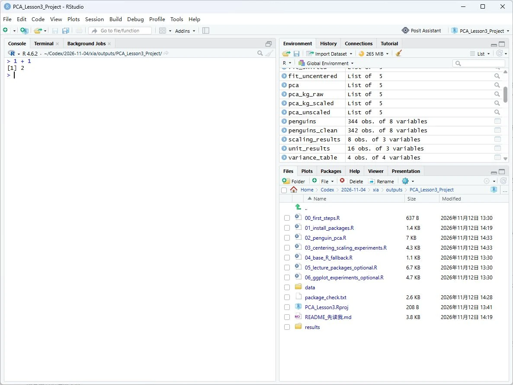

如果提示找不到 R，先确认 R 已装，再重启 RStudio；必要时在 RStudio 的 R 版本选择窗口选择实际安装的 R。学校电脑无安装权限时先联系 IT，不要下载来源不明的“修复工具”。

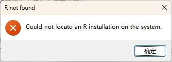

### 2. 新建项目 / Create a project

项目是把脚本、数据和图放在一起的文件夹。它对一次 PCA 不是数学上的必要条件，但能避免反复找文件。本节复用旧课真实截图，图中项目名为 **PCA_Practice**；这次请填写 **Wine_PCA**。菜单操作相同。

1. 点击 **File → New Project**。
2. 点击 **New Directory**，因为要新建文件夹。
3. 点击 **New Project**（普通项目）。
4. Directory name 输入 `Wine_PCA`；父文件夹用 Browse 选择自己的 Documents。不要启用 Git 或其他高级选项。
5. 点击 **Create Project**。右上应出现 Wine_PCA，右下 Files 应有 Wine_PCA.Rproj。

<p class="en">Choose File → New Project → New Directory → New Project. Name this project Wine_PCA. The reference screenshots show an earlier project called PCA_Practice; use the same buttons with the new name.</p>


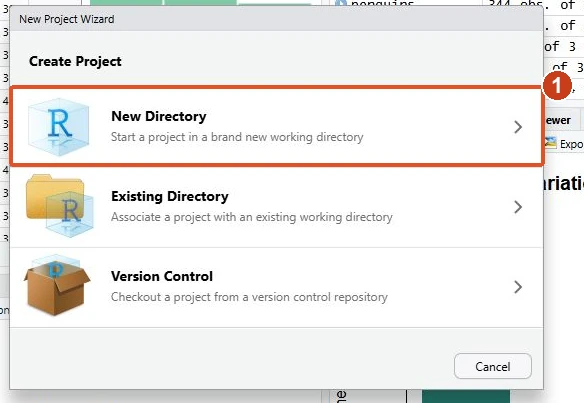
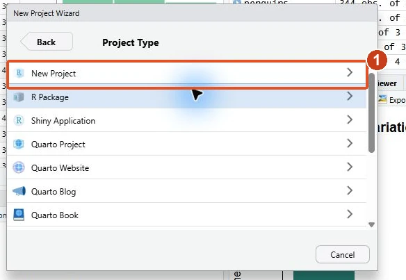
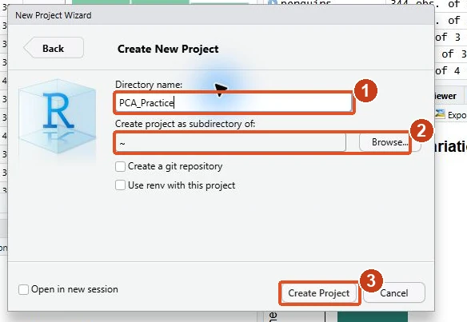
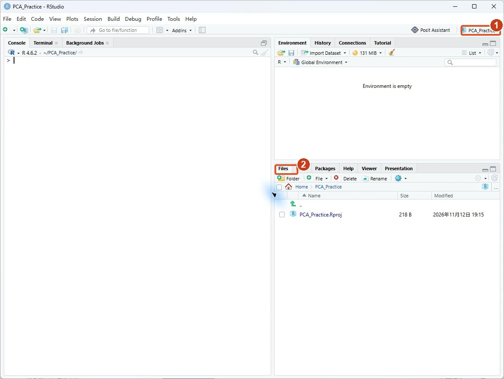

### 3. 新建 R 脚本 / Create an R script

按 **Ctrl + Shift + N**，或 File → New File → R Script。左上出现编辑区。这里写代码，左下 Console 看答案，右上 Environment 看已产生的对象，右下 Plots 看图。

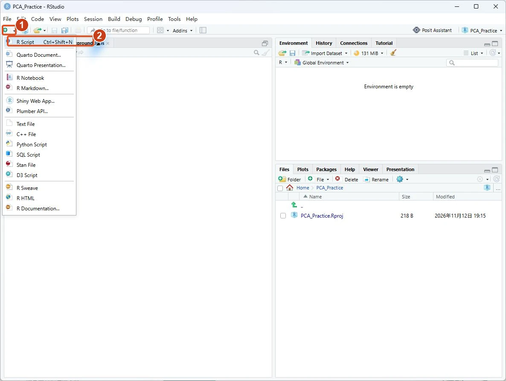
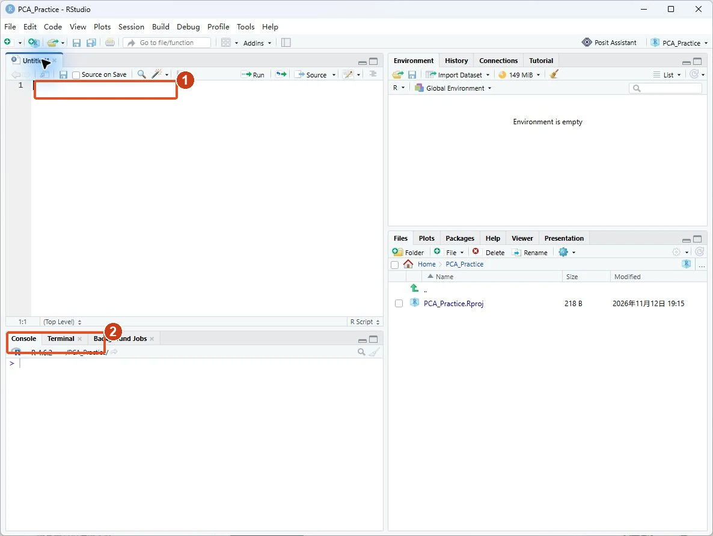

先亲手输入下面四行，不用一次复制整本教材：

```r
1 + 1
a <- c(2, 4, 6)
mean(a)
sd(a)
```

按 **Ctrl + S**，文件名写 `wine_practice.R`，保存到 Wine_PCA 项目中。`.R` 是脚本；`.Rproj` 是项目入口；`.csv` 是数据；`.html` 是教材网页。它们不能靠改扩展名互相转换。

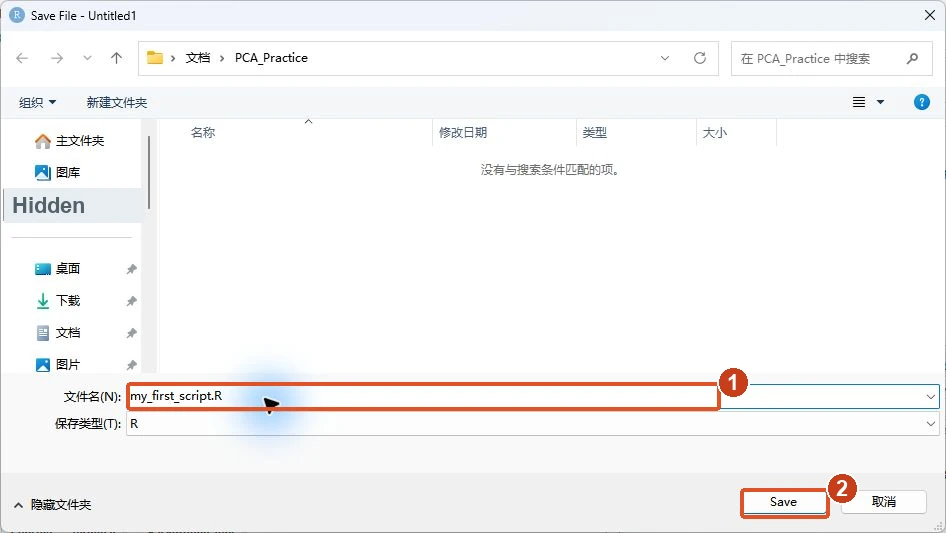

### 4. 保存不等于运行 / Saving is not running

光标放在第一行，按 **Ctrl + Enter**，或点编辑区上方 **Run**。Console 出现 `1 + 1` 和答案 2。再运行第二行，它创建 a，可能没有数字打印；第三行才打印均值 4。选中多行后 Ctrl+Enter 会按顺序运行选区。

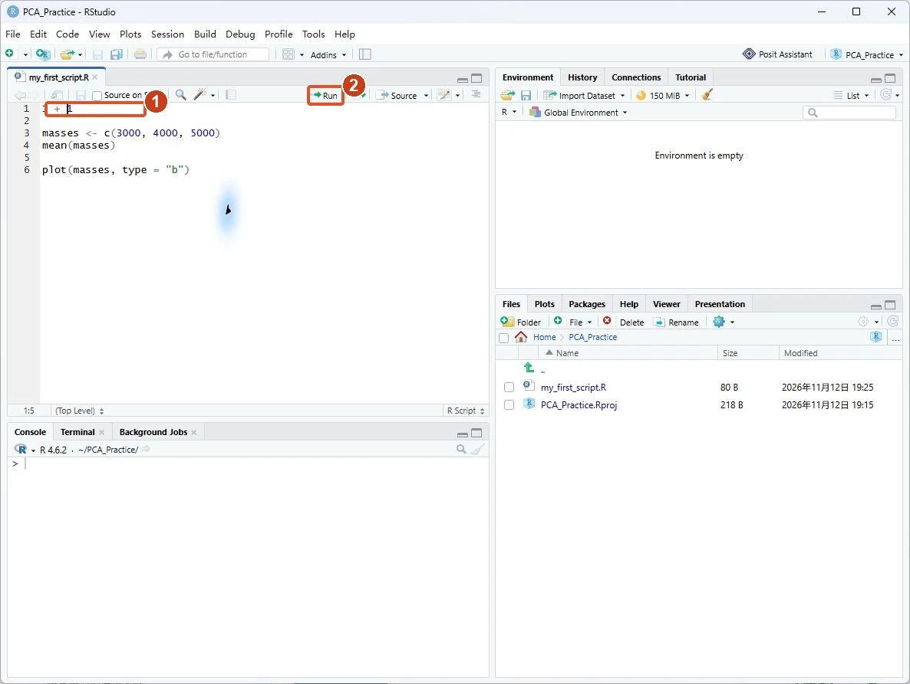
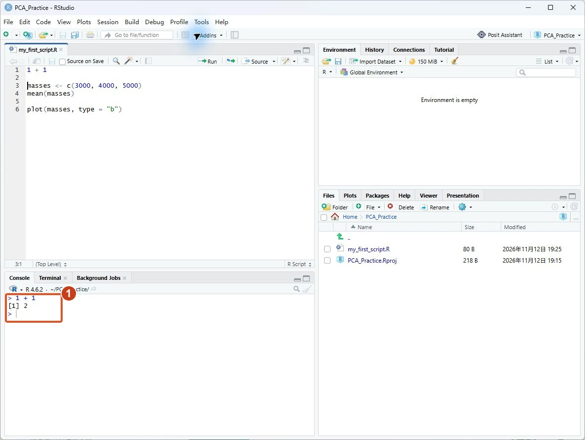
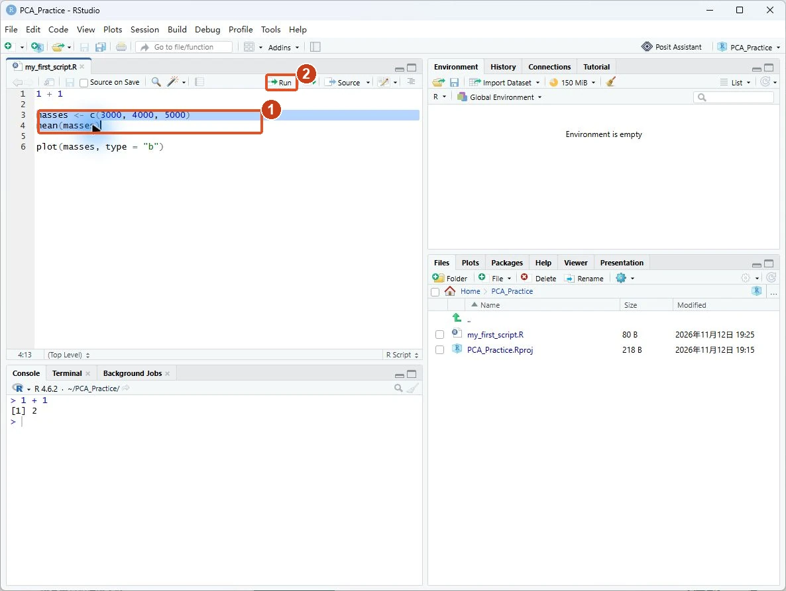

**Source** 从头运行整份脚本。刚学习时先分段 Run，知道每段的结果后再 Source。用 Source 时，单独写对象名不一定自动打印，要明确显示结果可用 `print(...)`。

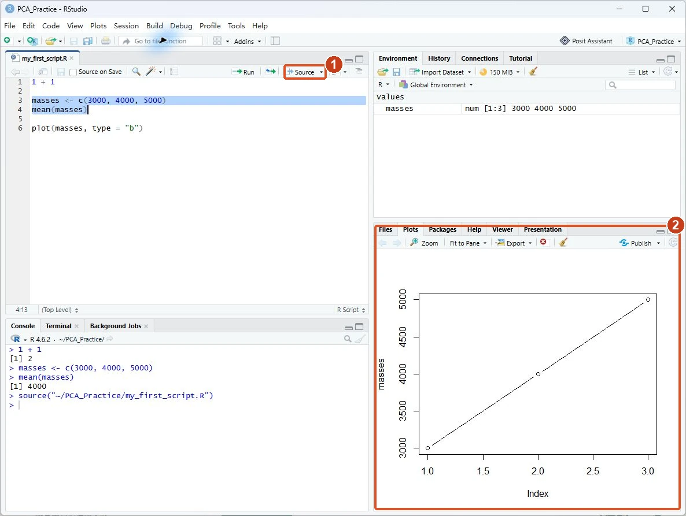

<details><summary>出问题先查这里 / Quick troubleshooting</summary><ul><li>Console 出现 `+`：多半有括号或引号没闭合；按 Esc 取消当前不完整语句，再检查脚本。</li><li>`object 'X' not found`：还没运行创建 X 的行，或重启后对象消失。重新从导入步骤运行。</li><li>红色报错：读第一条错误，不要把后续每条都当独立问题。</li><li>没有图：确认运行了 plot，不是只保存脚本；再点右下 Plots。</li><li>不要把 Console 自动出现的 `>`、`+` 提示符复制进脚本。</li></ul></details>

软件安装页面随版本会变化。上述图是已有真实 RStudio 操作截图，不是伪造的安装向导。本节之外，旧教材 [项目](../lesson3/#project)、[运行](../lesson3/#run) 章节提供同一流程的完整演示。

## 自己写导入代码：先让数据正确进来 / Import the Wine data yourself

### 1. 下载的是数据，不是代码 / Download the data

点击 [下载 Wine 数据表 wine.csv](wine.csv)，保存到自己的 Downloads。它是 UCI 原始 178 行数据的 CSV 副本，**没有标题行**。可以在 Excel 看，但分析时不要改数值或另存覆盖。我们下一步用文件选择窗口直接选它，不需要照抄别人的电脑路径。

<p class="en">This download is a data table, not a script. It contains the original 178 rows, including the cultivar in column 1, without a header row.</p>

### 2. 在 wine_practice.R 末尾亲手写这两行

```r
wine <- read.csv(file.choose(), header = FALSE)
dim(wine)
```

选中第一行，Ctrl+Enter。弹出窗口后打开 Downloads，选择刚下载的 **wine.csv**，点 Open。`file.choose()` 会等待你选文件，这是正常的；选文件之前不要继续乱点 Run。再运行 `dim(wine)`，必须得到 **178 14**。

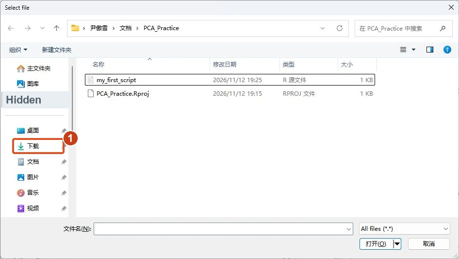
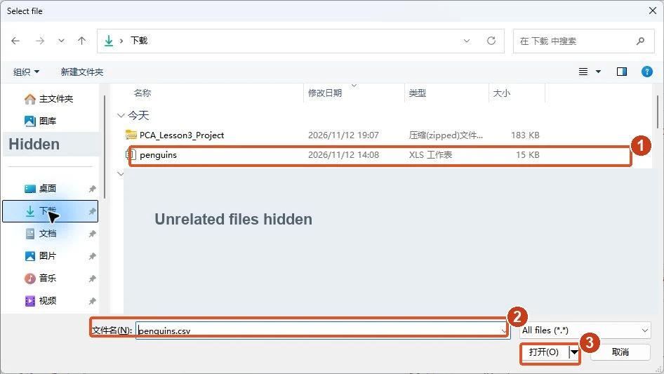

第一行从右往左读：`file.choose()` 给出选中的路径；`read.csv` 按逗号分隔读成数据表；`header=FALSE` 表示第一行也是数据，不是变量名；最后 `<-` 把表存成 wine。`dim` 返回行数、列数。如果误用默认 header=TRUE，第一瓶酒会被当标题，行数会少一行。

<p class="en">The expression is evaluated on the right, then stored under the name on the left. Always check the dimensions before running PCA.</p>

### 3. 给列起名 / Name the columns

```r
names(wine) <- c(
  "Cultivar", "Alcohol", "Malic_acid", "Ash",
  "Alcalinity_of_ash", "Magnesium", "Total_phenols",
  "Flavanoids", "Nonflavanoid_phenols", "Proanthocyanins",
  "Color_intensity", "Hue", "OD280_OD315", "Proline"
)
head(wine)
```

这段括号跨了几行，要选中整个 `names(...) <- c(...)` 语句一起运行。引号里面是名字，顺序必须与文件一致。`head` 显示前六行，不是只取六行来分析。

### 4. 保留标签，建立 X / Separate the label

```r
cultivar <- factor(wine$Cultivar)
X <- wine[, -1]
dim(X)
sum(is.na(X))
table(cultivar)
```

`$` 从表里取一列；`factor` 表示类别。方括号形式是 `[行, 列]`：逗号前留空表示所有行，`-1` 表示去掉第一列。`is.na` 判断缺失，`sum` 数有几个。预期 X 为 **178 13**，缺失个数 **0**，三组数量 **59、71、48**。

<p class="en">The label is retained separately. X contains only the 13 chemical measurements. No rows are removed in this dataset because these variables have no missing entries.</p>

<details><summary>练习：`wine[1, ]`、`wine[, 1]`、`wine[1:3, 2:4]` 各是什么？</summary><p>第一瓶酒的全部列；全部酒的第一列；前三瓶酒的第 2–4 列。R 从 1 开始编号。The comma separates row selection from column selection.</p></details>

以后重跑时 `file.choose()` 会再次弹窗。学会后可以把数据放进项目目录，改写为 `read.csv("wine.csv", header=FALSE)`；这要求 wine.csv 确实位于当前项目目录，而不是凭空输入这个名字。

## 两次 PCA：每行到底在干什么？ / Fit both PCA models and inspect the objects

### 1. 唯一改变的是 scale. / Change one setting

```r
p0 <- prcomp(X, center = TRUE, scale. = FALSE)
p1 <- prcomp(X, center = TRUE, scale. = TRUE)
summary(p0)
summary(p1)
```

`prcomp` 是 R 自带函数，不需要另装包。X 是相同的 13 列输入；`center=TRUE` 都减列均值；`scale.=TRUE` 再除以各列 SD。`scale.` 末尾的点是参数名的一部分。p0 与 p1 是你起的对象名，不是固定语法。

<p class="en">Both models centre the columns. Only p1 standardises them. This controlled comparison isolates the effect of scaling.</p>

`summary` 三行主要输出依次为：Standard deviation（√λ）、Proportion of Variance（每轴比例）、Cumulative Proportion（累计比例）。0.55406 是比例，乘 100 才是 55.406%。

### 2. 自己算百分比 / Calculate it rather than copying it

```r
lambda0 <- p0$sdev^2
lambda1 <- p1$sdev^2
share0 <- lambda0 / sum(lambda0)
share1 <- lambda1 / sum(lambda1)
c(Unscaled = sum(share0[1:2]) * 100,
  Standardised = sum(share1[1:2]) * 100)
```

`^2` 逐项平方；`sum` 加总；`[1:2]` 只取第一、第二项；`c` 把两项结果并排放在一起。这里依次得到约 **99.98271、55.40634**。

```r
sum(lambda0)
sum(lambda1)
sd(X$Proline)
sd(X$Hue)
var(X$Proline) / sum(sapply(X, var)) * 100
```

预期约 **99391.505、13、314.9075、0.22857、99.77384**。`sapply(X,var)` 对每一列调用 var，返回 13 个方差。把某个变量的方差除以总和，才得到它在原始总方差中的份额。

### 3. 查看载荷 / Inspect direction coefficients

```r
sort(abs(p0$rotation[, 1]), decreasing = TRUE)
sort(abs(p1$rotation[, 1]), decreasing = TRUE)
```

`rotation[,1]` 取第一主方向的 13 个系数；`abs` 只看绝对值；`sort(...,decreasing=TRUE)` 从大到小排。预期前两项为 raw：Proline 0.999823、Magnesium 0.017868；scaled：Flavanoids 0.422934、Total_phenols 0.394661。绝对值适合比较大小，分析正负关系时要看原来的带符号系数。

### 4. 把对象与数学核对 / Connect output to algebra

```r
Z <- scale(X, center = TRUE, scale = TRUE)
max(abs(cov(Z) - cor(X)))
max(abs(p1$x - Z %*% p1$rotation))
diag(cov(p1$x))[1:2]
p1$sdev[1:2]^2
```

`%*%` 是矩阵乘法，`*` 是逐项相乘；两者别混用。前两个误差应接近 0（例如 10⁻¹⁴ 量级，具体随平台变化）；最后两行应相同，约 **4.70585、2.49697**。浮点计算用“接近 0”判断，不强求所有位数恰好为 0。

<p class="en">These checks connect the software to the theory: covariance of standardised data equals correlation of raw data; scores equal data times directions; score variances equal eigenvalues.</p>

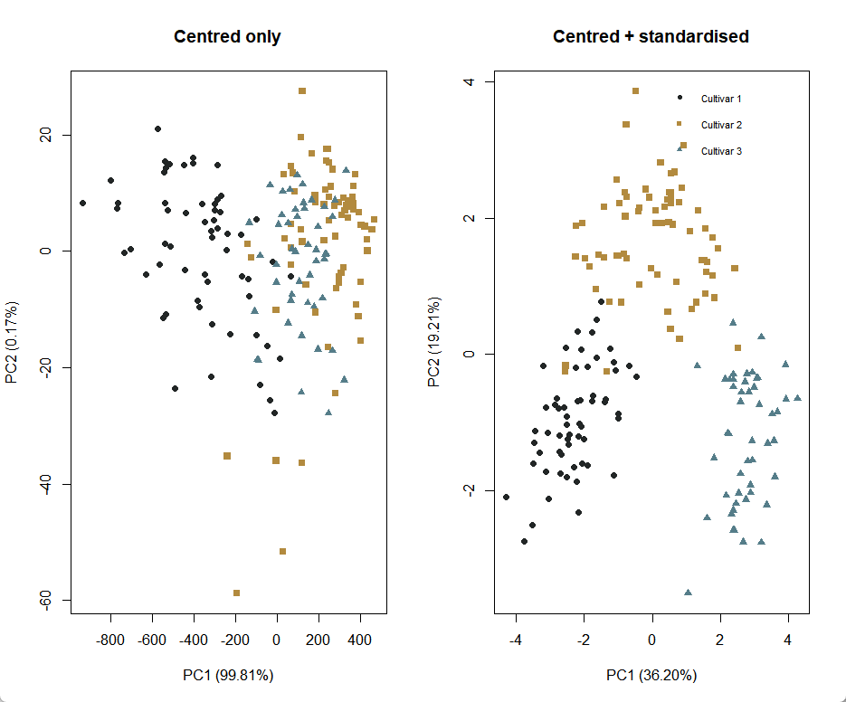

### 保存 / Save your own work

Ctrl+S 保存脚本。下次打开 Wine_PCA.Rproj，再打开 wine_practice.R，从导入开始顺序运行。保存脚本保留的是操作步骤；当前 Environment 里的对象不能代替一个可重现的脚本。

## 自己画图，再读懂一个点 / Draw the scores and explain every visual element

### 先画一张最简单的 / Begin with a plain plot

```r
plot(p1$x[, 1], p1$x[, 2],
     xlab = "PC1 (36.20%)", ylab = "PC2 (19.21%)",
     main = "Standardised Wine PCA")
```

先运行三行一起组成的语句。右下 Plots 应出现 178 个点。横坐标是第一 score 列，纵坐标是第二列。点不是变量，不是品种平均值，而是一瓶酒。重叠的点肉眼可能看不出全部 178 个。

### 再加入颜色和形状 / Add labels after fitting

```r
colours <- c("#222626", "#B28A3E", "#557D89")
symbols <- c(16, 15, 17)
group_id <- as.integer(cultivar)
plot(p1$x[, 1], p1$x[, 2],
     col = colours[group_id], pch = symbols[group_id],
     xlab = "PC1 (36.20%)", ylab = "PC2 (19.21%)",
     main = "Standardised Wine PCA")
legend("topright", legend = levels(cultivar),
       col = colours, pch = symbols, title = "Cultivar")
```

`pch` 控制点形：16 圆、15 方、17 三角。`group_id` 是每行标签对应的 1、2、3，拿它到 colours 里查颜色。`legend` 加图例。它们全部发生在 `prcomp` 之后，未重新计算方向。

<p class="en">Colour and shape encode cultivar membership. They are annotations of scores already computed without the labels.</p>

### 与 PPT 对照 / Compare the two analyses

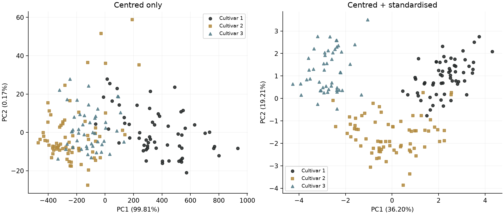

左图横向主要是 Proline 的变化，品种 2 与 3 的重叠较多；右图分组更清楚，但不能把“看上去分开”叫作预测准确率。图里没有训练分类器，也没有独立测试集。两张图分别调整了坐标范围，所以纸面上的一厘米不是同一种数值距离。

<div class="interactive" id="wine-lab"><h3>真实数据交互 / Explore the actual Wine scores</h3><div class="controls"><label>分析 <select id="wine-mode"><option value="unscaled">中心化、不标准化 / Unscaled</option><option value="scaled">中心化、标准化 / Standardised</option></select></label><label><input type="checkbox" id="wine-colour" checked> 显示品种 / Cultivar colours</label><label><input type="checkbox" id="wine-flip"> 反转 PC1 / Flip PC1</label></div><canvas id="wine-canvas" width="860" height="500" aria-label="Wine PCA score plot"></canvas><p id="wine-result" aria-live="polite"></p></div>

按顺序做三次实验：①不看颜色，描述点云形状；②打开颜色，描述组间关系；③反转 PC1。第③步只改变坐标的正负，不改变点间距离、解释率、分组结构或重建。

### 两个载荷数能说明多少？ / Interpreting the loading table

原始 PC1 的 Proline 系数约 0.9998，Magnesium 约 0.0179，其余更小，因此方向几乎贴着 Proline 轴。标准化 PC1 的 Flavanoids 约 0.4229、Total phenols 约 0.3947，多个变量参与同一方向。系数相近且同号表示它们在这个轴上同向贡献，不能因此断言因果。

变量 k 在前两轴中的表示质量可以用 **cos² 合计**量化：对标准化数据，Σⱼ₌₁² λⱼvₖⱼ²；对原始数据，再除以该变量原方差 sₖ²。大总解释率不保证每列的这个比例都大。

```r
quality1 <- rowSums(sweep(p1$rotation[, 1:2]^2,
                          2, p1$sdev[1:2]^2, "*"))
sort(quality1)
```

这段选前两列、系数平方、每列乘对应特征值、按行加总。它回答“每个变量在二维平面中表示得多好”，与“谁对 PC1 的方向贡献大”不同。

<details><summary>为什么你运行的图可能左右或上下相反？</summary><p>特征向量 v 与 −v 等价，软件可以任取其一。对应 score 同时变号，图就镜像。比较时看相对位置、距离、解释率和绝对载荷，而不是把左右朝向当作结论。A sign flip changes orientation, not the PCA solution.</p></details>

## 第一页：每一块内容怎样支撑论点？ / Slide 1: the question, mechanism and controlled comparison

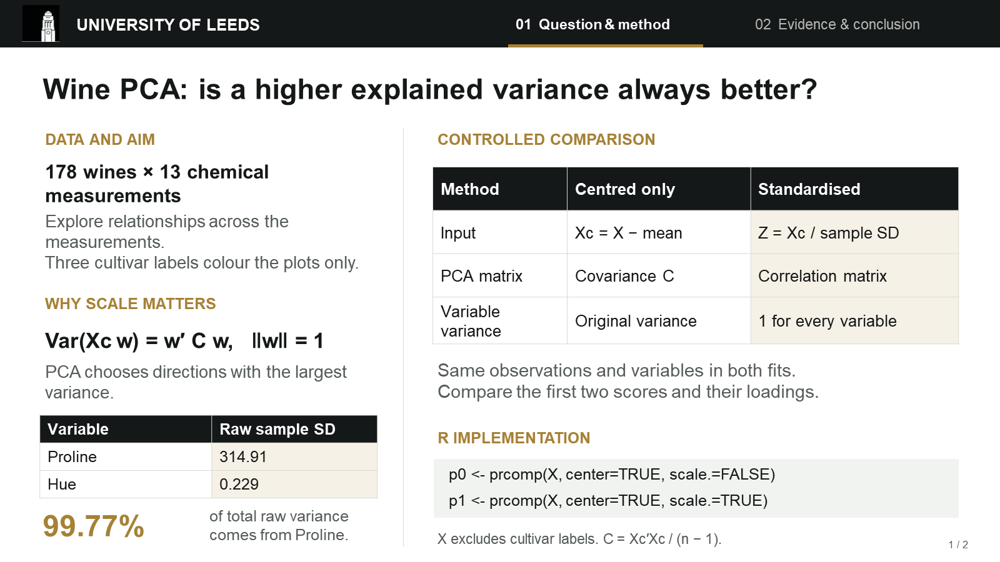

这页不是背景知识堆积，而是在建立一个可检验的疑问：如果某一列数值变化特别大，最大方差 PCA 是否就会主要追随它？

|指向哪里|你要解释的意思|自然的英语|
|---|---|---|
|标题|更高解释率是否就是更好结果？|Does a higher explained variance always mean a better PCA?|
|178 × 13|数据规模与分析目的；标签只上色|The aim is to explore the chemical measurements together.|
|方差公式|方向由最大化方差确定；w 需要单位长度|PCA looks for unit directions with the largest projected variance.|
|两个 SD|两变量数值尺度相差很大；中心化不会消除差异|These measurements have very different numerical scales.|
|99.77%|原始总方差已几乎由 Proline 构成|Proline accounts for almost all of the total raw variance.|
|两列方法对照|同样中心化；只有第二个再除以 SD|Both subtract the mean; only one divides by the standard deviation.|
|R 两行|同一数据、一项设置变化的对照|I kept the data fixed and changed only the scaling option.|

如果被问公式，你要能从 `t=Xc w` 开始推导，不只是念“w transpose C w”。C 是 13×13 的协方差矩阵，w 是 13 个方向权重；样本数 n=178 只出现在方差分母 177。

<p class="en">Slide 1 motivates the comparison. The standard deviations explain why scale matters; the two R calls show how that question was tested.</p>

### 容易被问住的细节

“给每个变量相同 starting variance”不是说它们对每个 PC 的载荷相同。标准化只使 C 的对角线都为 1，相关结构仍决定方向。

数据来自 UCI Wine，建议在 PPT 页脚添加简短出处，例如 **Data: UCI Wine dataset (178 observations; 13 features), archive.ics.uci.edu/dataset/109/wine**。当前文件截图没有清晰的数据出处；教材这里补足来源，便于你准备最终提交。

<details><summary>复述检查：只给你这页，30 秒说清实验设计。</summary><p>“I compare two PCA analyses of the same 178 wines. Both are centred; one is also standardised. The raw variances are very uneven, especially for Proline. I examine whether scaling changes the principal directions and the two-dimensional representation.”</p></details>

## 第二页：从证据走到有边界的结论 / Slide 2: results, interpretation and a justified choice

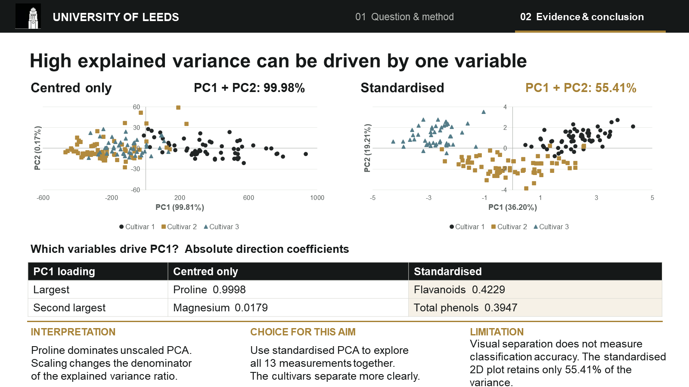

读图顺序是**上方百分比 → 下方载荷 → 点云分组 → 分析选择 → 局限**。这样观众先看见一个反常现象，再听到解释，而不是同时听五个互不相连的事实。

1. **百分比：**99.98% 对 55.41%。先说它们是前两个 PC 的累计比例，不能误说都是 PC1。
2. **载荷：**左边 Proline 的方向系数几乎为 1，解释了为何原始结果主要沿这列变化。
3. **点云：**右图多个测量参与方向，品种在这两个轴上分得更清楚。先说是观察，再说局限。
4. **选择：**目标是一起探索 13 项不同尺度的测量，因此选择标准化作为这个分析的起点。
5. **范围：**二维还漏掉约 45% 标准化方差，视觉分离也没有给出测试准确率。

<p class="en">The conclusion follows from the aim, the loadings and the plots together. The cumulative variance percentage alone is insufficient.</p>

PPT 中 “scaling changes the denominator” 可以口头补完整：**Scaling changes the covariance structure, the principal directions and the total variance.** 只说分母变了容易让人误以为方向没变；事实是整套几何关系都重新定义了。

### 哪些话不能从图推出？ / What the evidence does not establish

|观察支持|还需要额外工作|
|---|---|
|在此二维图上组间分离更清楚|独立测试数据上的分类准确率|
|原始 PC1 方向接近 Proline 轴|Proline 是最重要的生物学原因|
|两 PC 保留 55.41% 标准化总方差|所有变量都被表示得一样好|
|标准化适合当前探索目的|所有 PCA 数据都必须标准化|

面对“不如再多保留几个成分？”可以答：两成分是为了展示二维图；若要表示更多变异，可以查看碎石图和累计曲线。标准化 Wine 到 PC5 累计约 80.16%，到 PC8 约 92.02%。这是探索阈值的例子，不是通用的最佳维数规则。

<details><summary>老师说“99.98% 本来就很好，为什么不用？”你怎么答？</summary><p>“It is very good for preserving variation in the original scales. My aim, however, is to explore all thirteen measurements together. Because Proline dominates that raw metric, I also examine the standardised representation.” 中文：承认它对原尺度目标确实很好，再说明自己的目标不同，而不是把原始 PCA 判成算错。</p></details>

## 三分钟讲稿：逐段对着 PPT 讲 / A three-minute script, with pointing and meaning

下面沿用当前讲稿的论证顺序，并把“只改变分母”补成更完整的解释。约 320 词；按每分钟 115–125 词，加上指图停顿，目标接近三分钟。第一次请计时，动作提示和中文不读出声。

### 第一页，约 0:00–1:25 / Slide 1

**指标题，抛出问题。**

> Today, I’m asking whether a higher explained variance always means a better PCA.

今天我要讨论，解释方差更高是否一定代表更好的 PCA。这里的 better 需要分析目的来定义，后文会回答。

**指数据描述，先说数据和标签。**

> I used 178 wines with 13 chemical measurements. The aim is to explore these measurements together. The cultivar labels only colour the plots; they do not enter the PCA calculation.

我用了 178 瓶酒的 13 项化学测量，想把它们放在一起探索。品种只用于图上的颜色，不进入 PCA 计算。重点是让听众知道你没有把答案标签喂给无监督分析。

**指方差公式，然后移动到 SD 对比。**

> The formula here expresses the key idea: PCA looks for directions with the largest variance. But look at these standard deviations. Proline is about 315, while Hue is about 0.23. These are very different numerical scales.

公式说明 PCA 找方差最大的方向；两列 SD 差别很大。不要把 SD 念成 variance；方差还要平方。听众若追问约束，就解释方向长度必须为 1。

**指 99.77%，再指预处理两栏。**

> In fact, Proline accounts for 99.77 percent of the total raw variance. So it could dominate PCA before we even consider the other measurements. Both methods subtract the mean. The standardised version also divides by the standard deviation, giving every variable a starting variance of one.

原始总方差几乎由 Proline 构成。两法都中心化，第二种额外标准化；starting variance 指各原变量进入 PCA 时的方差。

**指 R 两行，然后翻页。**

> In R, I kept the same data and changed only the scaling option. Let’s look at the results.

这是一个清楚的对照实验：数据固定，设置只改一项。

### 第二页，约 1:25–3:00 / Slide 2

**左右各指一次百分比，停半秒。**

> Without standardisation, the first two components explain almost 100 percent of the variance. After standardisation, they explain about 55 percent. The left-hand result might seem better. But the table below explains why that percentage is so high.

先把观众的直觉说出来，然后引导他们往载荷表看。“前两个”不能省略成第一主成分。

**指 Proline 0.9998，再指标准化的两个载荷。**

> Proline’s coefficient is nearly one. The next largest is only about 0.018. So the first component mainly follows Proline. After standardisation, several measurements contribute to the first component.

这句话把数值与方向含义连起来。你不需要逐个读完小数位；0.018 对应 Magnesium。

**用手指品种 2、3 较重叠的区域，再指右图。**

> We can also see more overlap between these two cultivars on the left, and clearer separation on the right. Scaling changes the covariance structure, the principal directions and the total variance. So the two percentages are not directly comparable quality scores.

图是可见的探索证据；解释率则属于不同尺度，不能拿大小直接打分。

**指选择和局限，用一句收束研究问题。**

> For exploring all 13 measurements together, I would choose standardised PCA. But clearer separation does not prove classification accuracy. And the right-hand plot still leaves out about 45 percent of the standardised variance. My choice therefore depends on the loadings, the plots and the purpose of the analysis.

你作了具体选择，也说明证据的范围。最后一句回到标题：更高解释率并非单独足够的选择标准。

<div class="interactive"><h3>练习计时 / Rehearsal timer</h3><p id="timer" role="timer">0:00</p><button id="timer-toggle">开始 / Start</button> <button id="timer-reset">重置 / Reset</button><p>先只看 PPT 讲；卡住时记下卡点，回到对应章节。计时不等于理解测试。</p></div>

### 发音提示 / Useful pronunciations

variance /ˈveəriəns/；covariance /ˌkəʊˈveəriəns/；eigenvector /ˈaɪɡənˌvektə/；cultivar /ˈkʌltɪvɑː/；Proline /ˈprəʊliːn/。读数字时，99.98% 可以自然读 “almost one hundred percent”，载荷 0.9998 可读 “nearly one”。

## 分层问答：先短答，再解释为什么 / Questions: a short spoken answer, then the reasoning

先读问题，关掉答案用英语说 1–3 句，再展开。短答给你课堂表达的长度；中文解释负责检查你是否真的懂。

<div id="qa-prompt" class="interactive"><h3>抽一个追问 / Draw a question</h3><button id="random-question">随机抽题 / Random question</button><p id="random-result" aria-live="polite">先准备纸笔，说完再打开下面的答案。</p></div>

### A. 基础题 / Foundations

<details class="question"><summary>1. What is PCA doing to these wines?</summary><p class="en">It replaces the chemical measurements with new, uncorrelated coordinates ordered by variance. I use the first two coordinates to visualise the wines.</p><p>方向是原变量的线性组合。保留全部方向只是换坐标；丢掉后面的方向才是真正降维。</p></details>
<details class="question"><summary>2. Why do you centre the data?</summary><p class="en">Centring makes PCA describe variation around the sample mean, rather than the location of the cloud relative to the original zero.</p><p>未中心化的 XᵀX/(n−1) 包含均值位置项。设原均值向量为 μ，则 XᵀX=XcᵀXc+nμμᵀ；最大方向可能主要体现均值，而不是围绕均值的散布。</p></details>
<details class="question"><summary>3. Does centring give every variable variance one?</summary><p class="en">No. Centring gives mean zero. Dividing by the sample standard deviation gives variance one.</p><p>减常数不改变方差。先能说清这一点，才算分清两种预处理。</p></details>
<details class="question"><summary>4. Why are the labels excluded?</summary><p class="en">I want the directions to be determined by the chemical measurements alone. The cultivar labels are used afterwards to interpret the plot.</p><p>类别编码还没有连续数量含义。若把标签放进去，就改变了研究设计。</p></details>
<details class="question"><summary>5. Is PCA supervised learning?</summary><p class="en">Ordinary PCA is unsupervised: it finds directions using X without a response variable. We can inspect known labels afterwards.</p><p>后面用颜色检查分组没有把之前的拟合变成监督学习；若按标签挑设置，就需要承认选择过程中用了标签信息。</p></details>
<details class="question"><summary>6. What is the difference between a loading and a score?</summary><p class="en">In this presentation, a loading is a coefficient defining a principal direction. A score is the coordinate of one wine in that direction.</p><p>本例 rotation 是 13×13；x 是 178×13。解释系数与样本坐标时先检查维度。</p></details>
<details class="question"><summary>7. Why must w have unit length?</summary><p class="en">Otherwise I could increase the variance simply by multiplying w by a larger number. The unit-length constraint makes it a comparison of directions.</p><p>Var(Xc·aw)=a²Var(Xcw)。无约束时通常无有限最大值。</p></details>
<details class="question"><summary>8. Why does the largest eigenvalue give PC1?</summary><p class="en">The variance along a unit eigenvector equals its eigenvalue. Any unit direction gives a weighted average of the eigenvalues, so none exceeds the largest.</p><p>可以展开 w=Σaⱼvⱼ 并写 Σaⱼ²=1，而不必重新背一页求导。</p></details>
<details class="question"><summary>9. Are different PCs independent?</summary><p class="en">Their scores are uncorrelated in the analysed sample. Independence is stronger and does not follow in general.</p><p>联合正态是零相关可推出独立的一种特殊情形；普通 PCA 不要求正态。</p></details>

### B. 结果题 / The actual results

<details class="question"><summary>10. Why is the unscaled percentage so high?</summary><p class="en">Proline accounts for almost all of the raw total variance. The first unscaled direction is therefore very close to the Proline axis.</p><p>原变量方差份额 99.77%，第一方向 Proline 系数绝对值 0.9998，这两条证据互相支撑。</p></details>
<details class="question"><summary>11. Does 99.98% mean 99.98% classification accuracy?</summary><p class="en">No. It is the proportion of total variance retained by two components. No classifier or test accuracy was calculated here.</p><p>解释率是特征值之比；准确率是预测标签正确次数除以测试样本数。</p></details>
<details class="question"><summary>12. Why choose the result with only 55.41%?</summary><p class="en">My aim is to explore all thirteen differently scaled measurements together. Standardisation prevents their original numerical scales from setting the initial variance weights.</p><p>这不意味着 55.41 本身是一个优点。优点是度量更符合本次目的；只保留 55.41% 是必须说明的二维限制。</p></details>
<details class="question"><summary>13. Does scaling change only the denominator?</summary><p class="en">It changes the whole covariance structure and therefore generally changes both directions and eigenvalues, as well as total variance.</p><p>R=D⁻¹CD⁻¹ 不是一般的相似变换 D⁻¹CD，因此不保留原特征值。标准化不是把最后百分比换个分母这么简单。</p></details>
<details class="question"><summary>14. Why is the standardised total variance 13?</summary><p class="en">There are thirteen non-constant variables, each with sample variance one. Their variances, and equivalently the eigenvalues, sum to thirteen.</p><p>前提是使用与 prcomp 一致的样本 SD。若改用分母 n 的缩放而仍以 n−1 算方差，数字会不同。</p></details>
<details class="question"><summary>15. Why do you use two components?</summary><p class="en">Two components give a readable two-dimensional plot. They are a visualisation choice, not a claim that two is optimal for every task.</p><p>对重建、预测、噪声识别要另设评估目标，不能因为有三种酒就自动要求三个 PC。</p></details>
<details class="question"><summary>16. Your plot is mirrored compared with mine. Is it wrong?</summary><p class="en">The sign of each principal direction is arbitrary. Reversing a direction and its scores reflects the plot without changing the analysis.</p><p>v→−v，t→−t，所以 tvᵀ 重建不变。</p></details>
<details class="question"><summary>17. Are the four loadings percentages?</summary><p class="en">They are absolute direction coefficients. They are not explained-variance percentages or classification scores.</p><p>单位特征向量的系数平方之和为 1，但单个系数本身不是方差份额；相关载荷还需要乘 √λ。</p></details>
<details class="question"><summary>18. Is Proline biologically the most important measurement?</summary><p class="en">The analysis shows that Proline dominates the raw numerical variance. Biological importance would require a scientific question and further evidence.</p><p>数值大小、测量单位、变化范围会决定原方差，不能直接得出机制或因果结论。</p></details>
<details class="question"><summary>19. Do points close together represent identical wines?</summary><p class="en">They have similar scores on the two displayed directions. They may differ in components omitted from the plot.</p><p>二维投影会压缩或完全丢掉某些差异；应结合余下方差解释距离。</p></details>

### C. 深入追问 / Research-level follow-ups

<details class="question"><summary>20. Should we always standardise?</summary><p class="en">It depends on the metric we want. Standardising is useful for differently scaled variables, but may amplify low-variance noise. Raw covariance PCA can be appropriate when the original variances are scientifically meaningful.</p><p>同单位也可能需要标准化，不同单位也不自动保证“所有列应同等起步”。预处理是建模选择。</p></details>
<details class="question"><summary>21. How is SVD related to the covariance eigenvectors?</summary><p class="en">If the preprocessed matrix is USVᵀ, its covariance is VS²Vᵀ divided by n−1. So the right singular vectors give the PCA directions.</p><p>要说明作用在中心化或标准化之后的矩阵上，避免把未处理原矩阵直接代入。</p></details>
<details class="question"><summary>22. Can we reconstruct the original data?</summary><p class="en">Using every nonzero component, we can reconstruct the preprocessed data up to rounding. With fewer components, we obtain its best rank-k squared-error approximation.</p><p>标准化结果还要乘回 SD、加回均值。最好近似是针对所用尺度，而非所有可能目标。</p></details>
<details class="question"><summary>23. How would you test whether the visual separation predicts cultivar?</summary><p class="en">I would define a classifier and evaluate it on unseen data. The means, scales and PCA directions would be fitted within the training data, including inside each cross-validation fold.</p><p>不能先用全体数据标准化/PCA 再声称测试完全独立。探索全数据可以，但预测评估有更严格的数据分离要求。</p></details>
<details class="question"><summary>24. What would you do with missing values or outliers?</summary><p class="en">I would inspect their origin and choose a documented treatment. Ordinary PCA can be sensitive to outliers; imputation or robust methods require their own assumptions.</p><p>Wine 本例无缺失，因此没有偷偷删行。不能因为某点远就自动删掉；它可能是真实结构。</p></details>
<details class="question"><summary>25. What if two eigenvalues are equal?</summary><p class="en">The individual directions in that eigenspace are not unique. The subspace is the stable object, and different orthonormal bases give the same retained variance.</p><p>只有接近重根时也可能出现方向不稳定，应比较子空间和谱间隔，而不只逐项比较系数。</p></details>
<details class="question"><summary>26. What is a reasonable next experiment?</summary><p class="en">I would change one variable's unit and compare both PCA fits, then examine more components and per-variable reconstruction quality.</p><p>该实验直接测试“尺度导致结果变化”的机制，比只换配色更能支撑论点。</p></details>
<details class="question"><summary>27. Does this presentation summarise a specific application paper?</summary><p class="en">It is my real-data R application using the UCI Wine dataset. The interpretation is supported by standard PCA theory; I would cite the dataset and the theoretical sources separately.</p><p>老师邮件允许真实数据的 R 应用路线。不要把这两页冒称为一篇并未选择的论文总结。</p></details>
<details class="question"><summary>28. How does this connect to principal components regression?</summary><p class="en">PCR uses PCA scores as predictors in a regression. Directions with high predictor variance need not be the directions most useful for predicting the response.</p><p>这是当前汇报的延伸：高解释率不能自动等同于任何任务中的“好”。PCR 要用预测误差选择维数，详见文献教材。</p></details>

## 最后用题目检验：真的能独立讲了吗？ / Practice problems and a teach-back test

### 练习 1：手算一个完整二维 PCA / A complete small example

合成数据为 (−2,−1)、(0,0)、(2,1)。它已经中心化。计算 C、最大特征值、第一单位特征向量、三个 scores 和解释率。

<details><summary>完整解答 / Worked solution</summary><p>C 的两列方差是 4 和 1，协方差是 2，因此 C=[[4,2],[2,1]]。特征多项式 λ²−5λ=0，特征值 5、0。第一方向可取 (2,1)/√5。scores 是 −√5、0、√5，它们的样本方差是 5。PC1 解释 100%，因为三点完全在同一条直线上。把 scores 乘回该方向，可以精确重建三个点。</p><p class="en">The data have rank one. One component is sufficient because there is no variation perpendicular to the line.</p></details>

### 练习 2：再标准化 / Now standardise it

上题两列 SD 是 2 和 1。写出 Z、相关矩阵、第一方向。比较原坐标里的第一方向。

<details><summary>完整解答 / Worked solution</summary><p>Z 的行是 (−1,−1)、(0,0)、(1,1)。相关矩阵是 [[1,1],[1,1]]，特征值 2、0，方向是 (1,1)/√2。与原始 (2,1)/√5 不同：标准化改变了度量，但此例依旧只有一条线，因此两者 PC1 解释率均为 100%。这也说明“标准化一定降低解释率”是错的。</p></details>

### 练习 3：用特征值回答，而不是凭感觉

标准化三个变量的特征值是 1.8、0.9、0.3。前两成分保留多少方差？丢掉部分的总平方误差是多少（n=11）？

<details><summary>完整解答 / Worked solution</summary><p>总和 3，与三个单位方差变量一致；比例 (1.8+0.9)/3=90%。丢掉方差为 0.3，总平方重建误差=(11−1)×0.3=3。两个量一个是比例，一个是元素平方误差总和，不要混成同一个数。</p></details>

### 练习 4：设计单位变换实验 / Change one unit

在自己的脚本中写：复制 X 为 X2，把 Proline 除以 1000；分别运行不标准化和标准化 PCA。先写预测，再运行。比较解释率和绝对载荷。

<details><summary>参考实现与解释 / Reference and explanation</summary><pre><code>X2 &lt;- X
X2$Proline &lt;- X2$Proline / 1000
q0 &lt;- prcomp(X2, center = TRUE, scale. = FALSE)
q1 &lt;- prcomp(X2, center = TRUE, scale. = TRUE)
sum(q0$sdev[1:2]^2) / sum(q0$sdev^2)
sum(q1$sdev[1:2]^2) / sum(q1$sdev^2)
max(abs(abs(q1$rotation) - abs(p1$rotation)))</code></pre><p>原始 PCA 通常改变；标准化后的矩阵相同，解释率应不变，最后误差接近零。本数据特征值无精确重根，因而可这样按列比较绝对载荷。重复特征值时应比较子空间。</p></details>

### 练习 5：评估每个变量 / Per-variable quality

用前两 PC 重建 p0，分别计算每列残差方差除以原方差，观察即使总体解释率接近 100%，是否仍有变量表示得不好。

<details><summary>参考实现 / Reference</summary><pre><code>Xc &lt;- scale(X, center = TRUE, scale = FALSE)
Xhat &lt;- p0$x[, 1:2] %*% t(p0$rotation[, 1:2])
residual &lt;- Xc - Xhat
retained &lt;- 1 - apply(residual, 2, var) / sapply(X, var)
sort(retained)</code></pre><p>每个 retained 是对应变量方差被两轴保留的比例。它与把所有变量的绝对方差加总后得到的总比例不同。原尺度下巨大的 Proline 方差能掩盖其他变量的相对损失。</p></details>

### 练习 6：纠正四句话 / Correct the statements

“PCA 选出最重要的两个原变量。”“标准化以后每个载荷都一样。”“右图是 55.41% 的准确率。”“PC1 负号说明结果错了。”

<details><summary>参考答案 / Corrections</summary><p>PCA 选新方向，通常混合多个原变量；标准化相等的是输入列方差，载荷由相关结构决定；55.41% 是两个 PC 的累计解释方差；整体方向符号任意。Try saying all four corrections in English without reading the glossary.</p></details>

### 研究型延伸 / A small extension with a clear question

问题：标准化是不是会放大测量噪声？在合成数据中加一列方差很小的独立噪声，比较缩放前后载荷和重建。说明数据如何生成、噪声如何定义、用了多少次重复。报告观察到什么，避免从一次模拟推断“所有标准化都不可靠”。

### 汇报准备通过标准 / Ready-to-present checklist

<div class="checklist"><label><input type="checkbox">我能不用稿子解释一个点、一个载荷、一个百分比。</label><label><input type="checkbox">我能手算练习 1，并指出各矩阵维度。</label><label><input type="checkbox">我能从空白脚本导入数据、运行两种 PCA、画图。</label><label><input type="checkbox">我能说明标准化为什么改变整个问题，而不只分母。</label><label><input type="checkbox">我能承认原始 PCA 对原尺度重建很好，同时解释自己的选择。</label><label><input type="checkbox">我能在三分钟内讲完，并回答随机的五个追问。</label></div>

## 术语、资料与复习索引 / Glossary, sources and what was verified

|English|中文|最短解释|
|---|---|---|
|observation|观测 / 样本|一行，一瓶酒|
|variable / feature|变量 / 特征|一列测量|
|centred data|中心化数据|每列减均值|
|standardisation|标准化|本例每列减均值、除样本 SD|
|covariance|协方差|偏差乘积的平均（样本用 n−1）|
|correlation|相关系数|无量纲的协方差|
|loading / direction coefficient|载荷 / 方向系数|本教材是 prcomp 的 rotation|
|score|主成分得分|样本在新轴上的坐标|
|eigenvalue|特征值|主成分 score 的方差|
|singular value|奇异值|σ，满足 λ=σ²/(n−1)|
|explained variance ratio|解释方差比例|该轴方差 / 当前总方差|
|scree plot|碎石图|依序画特征值或解释率|
|orthogonal|正交|方向点积为 0|
|reconstruction|重建|由保留的 scores 与 directions 算回近似数据|
|cultivar|栽培品种|本例的 3 个类别|
|data leakage|数据泄漏|评估时用到了不该提前知道的测试信息|

### 资料 / Sources

1. [UCI Machine Learning Repository: Wine](https://archive.ics.uci.edu/dataset/109/wine)，原始文件 wine.data 与 wine.names；178 个观测，13 项化学测量，类别数 3。网站提供数据与来源说明；本教材的数据文件保留原值、无标题行。
2. [R stats: prcomp](https://stat.ethz.ch/R-manual/R-devel/library/stats/html/prcomp.html)，SVD、center、scale.、sdev、rotation、x 的定义。
3. [R base: scale](https://stat.ethz.ch/R-manual/R-devel/library/base/html/scale.html)，列中心化与缩放的定义。
4. Jolliffe, I. T. (2002), *Principal Component Analysis*, 2nd ed., Springer，基础理论及第 8 章回归；[出版社页面](https://doi.org/10.1007/b98835)。
5. Bishop, C. M. (2006), *Pattern Recognition and Machine Learning*, Chapter 12，最大方差、最小重建误差与概率解释；[作者书籍页面](https://www.microsoft.com/en-us/research/people/cmbishop/prml-book/)。
6. 软件操作：[CRAN](https://cran.r-project.org/bin/windows/base/)、[RStudio Desktop](https://posit.co/download/rstudio-desktop/)、[Posit 执行代码说明](https://docs.posit.co/ide/user/ide/guide/code/execution.html)。

### 核对说明 / Verification notes

本教材使用当前两页 Wine PPT 的截图和课堂讲稿结构。用户在 R 4.6.2 中运行了两种 PCA，贴出了累计解释率与四个载荷；这些数值另经独立矩阵计算核对。参考得分图按同一数据重绘，为与 PPT 对照统一了轴符号。交互投影例子明确使用合成数据；Wine 交互使用真实 178 行计算结果。

Windows 操作图来自已有真实 RStudio 教程；图中的旧项目名/旧数据名在说明中明确区分。教材没有把旧企鹅图冒充为 Wine 实验。新扩展练习提供可检查的公式与代码，不把未在本机完整执行的扩展称作实测结果。

<p class="en">The central Wine results were supplied from a successful R run and checked independently. Extension exercises are labelled as exercises. Source material, observation, interpretation and suggested follow-up are kept distinct.</p>

这是个人学习资料，不是利兹大学官方教材。用于作业时，请用你理解后的表达，核对本学期具体提交要求。学习下一步：[PCA 文献阅读室](../reading/)。